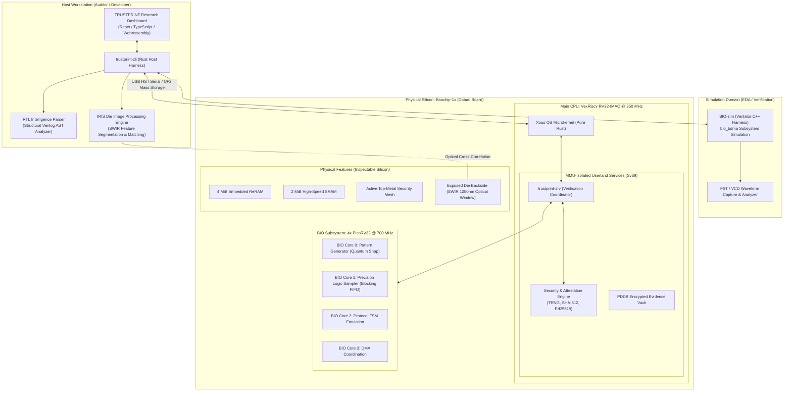

# TRUSTPRINT
### Open-Silicon Physical Identity and Behaviour Verification Laboratory

> *"Verify the silicon. Authenticate the evidence."*

[](LICENSE)
[](https://github.com/sarangchaudhari635-oss/TRUSTPRINT)
[](https://github.com/baochip/dabao)
[-red.svg)](https://github.com/betrusted-io/xous-core)
[-green.svg)](https://github.com/baochip/bio-sim)
[](https://crossbar-inc.com/pages/dabao-hackathon)

---

## 1. Project Overview

**TRUSTPRINT** is an open-source hardware verification, inspection, and attestation platform built specifically for the **Baochip-1x (bao1x)** RISC-V System-on-Chip on the **Dabao** development board.

As open-source silicon moves from academic synthesis to commercial fabrication (TSMC 22nm ULL), a fundamental trust gap emerges: **How does an end-user or security auditor know that a physical piece of packaged silicon authentically embodies its published Register-Transfer Level (RTL) design without relying blindly on proprietary foundry attestations?**

TRUSTPRINT answers this challenge by introducing a multi-tiered verification pipeline combining:
1. **RTL Design Analysis:** Static structural parsing of published open-source Verilog/SystemVerilog sources to extract module topologies, pin interfaces, register sets, and expected state transition dynamics.
2. **BIO I/O Experimentation:** Jitter-free, cycle-accurate stimulus-response probing executed across the 4x 700 MHz PicoRV32 BIO coprocessor cores to verify deterministic behavioral conformance.
3. **IRIS Physical Die Inspection:** Non-destructive infrared (SWIR ~1050nm) backside optical die analysis to cross-correlate physical macro-structures (SRAM banks, ReRAM tiles, core clusters, security mesh) against design floorplans.
4. **MMU Process Isolation:** High-assurance separation inside the pure-Rust microkernel **Xous**, ensuring untrusted test vectors cannot compromise verification keys, attestation roots, or hardware audit logs.
5. **Hardware-Backed Cryptographic Evidence:** Generation of tamper-evident, SHA-512 hashed, and Ed25519-signed verification certificates anchored in on-chip TRNG entropy and hardware crypto engines.

---

## 2. Research Integrity & Epistemic Boundaries

TRUSTPRINT operates on strict principles of scientific transparency. We explicitly delineate what software and physical experiments can prove versus what they cannot prove:

| Verification Tier | What It Proves | What It Cannot Prove |
| :--- | :--- | :--- |
| **RTL Analysis** | Structural properties and expected clock-by-clock signal interfaces described in source code. | That the fabricated physical chip actually matches that source code. |
| **BIO-sim Simulation** | That the Verilated RTL model behaves as specified under given test vectors. | Real-world silicon effects, propagation delay anomalies, or physical mask edits. |
| **BIO Hardware I/O** | That observable physical pins exhibit expected logical, state-machine, and timing transitions at 700 MHz. | Transistor-level equivalence or absence of dormant trojans hidden in unrouted gates. |
| **IRIS Die Inspection** | That macroscopic physical layout (macro-blocks, power rings, memory arrays) conforms to published floorplans. | Individual standard-cell gate connectivity, dopant-level modifications, or sub-micron routing hacks. |
| **Cryptographic Attestation** | That an evidence package was signed on a specific device using a verified hardware key without tampering. | That the underlying silicon physics were completely immutable before key generation. |

---

## 3. System Architecture



---

## 4. Hardware & Software Requirements

### Hardware Requirements
- **Target Evaluation Board:** [Dabao Board](https://github.com/baochip/dabao) featuring the Baochip-1x (BAO1X2S4F-WA) SoC.
- **Interconnect:** USB-C cable (High-Speed USB 2.0 communication, mass storage flashing, serial console).
- **Optional Physical Inspection:** Optical SWIR microscope or calibrated high-resolution infrared die photography fixture (~1050 nm illumination).
- **Probing / Logic Analysis (Optional):** Saleae Logic Pro or external oscilloscope for external cross-verification of BIO pin-toggling.

### Software Requirements
- **Host OS:** Linux (Ubuntu 22.04 LTS / Debian 12 / Arch), macOS, or Windows 11 with WSL2 / PowerShell 7.
- **Rust Toolchain:** Rust `stable` (1.75+) and `nightly` with RISC-V targets (`riscv32imac-unknown-none-elf`, `riscv32imac-unknown-xous-elf`).
- **Xous Toolchain:** `cargo-xtask` workflow configured for `betrusted-io/xous-core`.
- **BIO Toolchain:** Zig 0.12+ (providing Clang/LLVM for RV32E embedded compilation) or xPack RISC-V GCC.
- **Simulation Suite:** Verilator 5.0+, C++17 compiler (GCC / Clang), CMake, Make.
- **Waveform Analysis:** GTKWave or Surfer (supporting `.fst` and `.vcd`).
- **Python Environment:** Python 3.11+ with `pyserial`, `cbor2`, `cryptography`, `matplotlib`, `numpy`.

---

## 5. Quickstart & Workflow

### Clone the Repository
```bash
git clone https://github.com/sarangchaudhari635-oss/TRUSTPRINT.git
cd TRUSTPRINT
```

### A. Environment Verification
```bash
# Verify Rust and RISC-V cross-compilation targets
rustc --version
rustup target list | grep riscv32

# Verify Verilator for BIO simulation
verilator --version
```

### B. Simulating BIO Experiments (Software Safe)
Before deploying code to physical hardware, all stimulus programs must pass cycle-accurate verification in `bio-sim`:
```bash
# Clone and build BIO-sim
git clone https://github.com/baochip/bio-sim.git
cd bio-sim
make build

# Run deterministic GPIO timing experiment
./simulate configs/hello-world.jsonc

# Inspect generated waveform
gtkwave waveform/bio.fst
```

### C. Building the Xous TRUSTPRINT Firmware
```bash
# Clone Xous-core repository
git clone https://github.com/betrusted-io/xous-core.git
cd xous-core
git fetch --tags

# Build TRUSTPRINT application bundle for Dabao
cargo xtask dabao trustprint-app
```

### D. Flashing the Dabao Hardware (Safety-Gated)
> [!IMPORTANT]
> Always verify that flashing images do not overwrite factory provisioning secrets. Never toggle hardware fuses or perform irreversible security transitions without explicit operator confirmation.

1. Hold down the physical **PROG** button while inserting the USB-C cable.
2. The board enumerates as a USB Mass Storage drive labelled `BAOCHIP`.
3. Copy `loader.uf2`, `xous.uf2`, and `apps.uf2` to the drive.
4. Press **PROG** once more to reboot into the operating system.
5. Connect serial terminal:
   ```bash
   python -m serial.tools.miniterm /dev/ttyUSB0 115200
   ```

---

## 6. Project Roadmap

- [x] **Phase 0: Research, Feasibility & Formal Documentation** (Current)
- [ ] **Phase 1: Toolchain Validation & BIO Simulation Harness**
- [ ] **Phase 2: RTL Intelligence & Signal Parsing Engine**
- [ ] **Phase 3: BIO Stimulus & Deterministic Probing Engine**
- [ ] **Phase 4: Waveform Parser & Transition Conformance Engine**
- [ ] **Phase 5: Physical Dabao Board Integration & Pin Probing**
- [ ] **Phase 6: IRIS Die Inspection & Structural Registration**
- [ ] **Phase 7: Hardware Cryptographic Evidence & Attestation Engine**
- [ ] **Phase 8: Xous MMU Isolation Architecture & System Services**
- [ ] **Phase 9: Operator Research Dashboard (Local GUI)**
- [ ] **Phase 10: Full Pipeline Integration & Reproducibility Audit**
- [ ] **Phase 11: Hackathon Submission, Live Demonstration & Archive**

---

## 7. Evidence Reports & Data Integrity

TRUSTPRINT generates structured, cryptographically signed JSON evidence packages (`.tpe` - TrustPrint Evidence) formatted as follows:

```json
{
  "trustprint_version": "0.1.0-alpha",
  "experiment_id": "EXP-20261112-BIO-001",
  "timestamp_utc": "2026-11-12T18:30:00Z",
  "target_silicon": {
    "soc": "Baochip-1x (BAO1X2S4F-WA)",
    "process_node": "TSMC 22nm ULL",
    "board": "Dabao v3c",
    "dna_unique_id_hash": "e3b0c44298fc1c149afbf4c8996fb92427ae41e4649b934ca495991b7852b855"
  },
  "verification_tier": "PHYSICAL_IO_BEHAVIOURAL",
  "assertions": {
    "expected_frequency_hz": 700000000,
    "observed_period_jitter_ps": 124,
    "conformance_result": "PASS"
  },
  "provenance": {
    "signing_mode": "HARDWARE_TRNG_ED25519",
    "public_key": "3d4f2bf07dc1be38b20cd6e46949e1071f9d0e3d...",
    "signature": "8a7c1b...[64-byte signature]..."
  }
}
```

---

## 8. License & Acknowledgements

This project is licensed under the **MIT License** — see the [LICENSE](LICENSE) file for details.

### Acknowledgements & Upstream Foundations
- **Andrew "bunnie" Huang** for pioneering the Baochip-1x architecture, the BIO coprocessor concept, and the IRIS inspection methodology.
- **Betrusted.io Team** for the **Xous OS** microkernel and capability-based operating environment.
- **CrossBar Inc.** for organizing the Dabao Open Hardware Hackathon and driving open silicon innovation.
- **VexRiscv & PicoRV32 Authors** (Charles Papon, Claire Wolf) for providing foundational open-source RISC-V compute engines.

