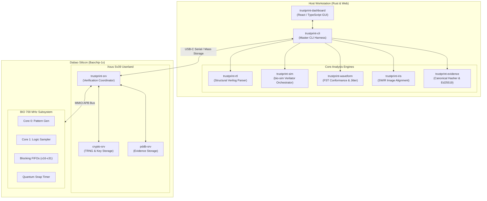

# Architecture — Component Decomposition

**Document Reference:** ARCH-COMP-001  
**Project:** TRUSTPRINT  
**Version:** 0.1.0-alpha  

---

## 1. High-Level Component Structure

---

## 2. Component Interface Contracts

| Component | Inbound Interface | Outbound Interface | Storage / State |
| :--- | :--- | :--- | :--- |
| **`trustprint-rtl`** | Path to Verilog source files | Structured JSON AST (ports, clocks, registers) | Stateless |
| **`trustprint-sim`** | Simulation config (`.jsonc`), BIO firmware binary | Raw `.fst` waveform trace, cycle log | Temporary disk cache |
| **`trustprint-waveform`** | `.fst` waveform file, expected timing rules | Conformance verdict (PASS/FAIL), jitter statistics | Stateless |
| **`trustprint-iris`** | SWIR PNG micrograph, CAD floorplan JSON | Aligned visual overlay, correlation index | In-memory canvas |
| **`trustprint-evidence`** | Experiment manifest, artifact hashes | Signed `.tpe` canonical JSON bundle | Persistent filesystem / PDDB |
| **`trustprint-srv`** | USB CDC serial commands | BIO MMIO writes, Xous IPC messages | Xous userland heap |

