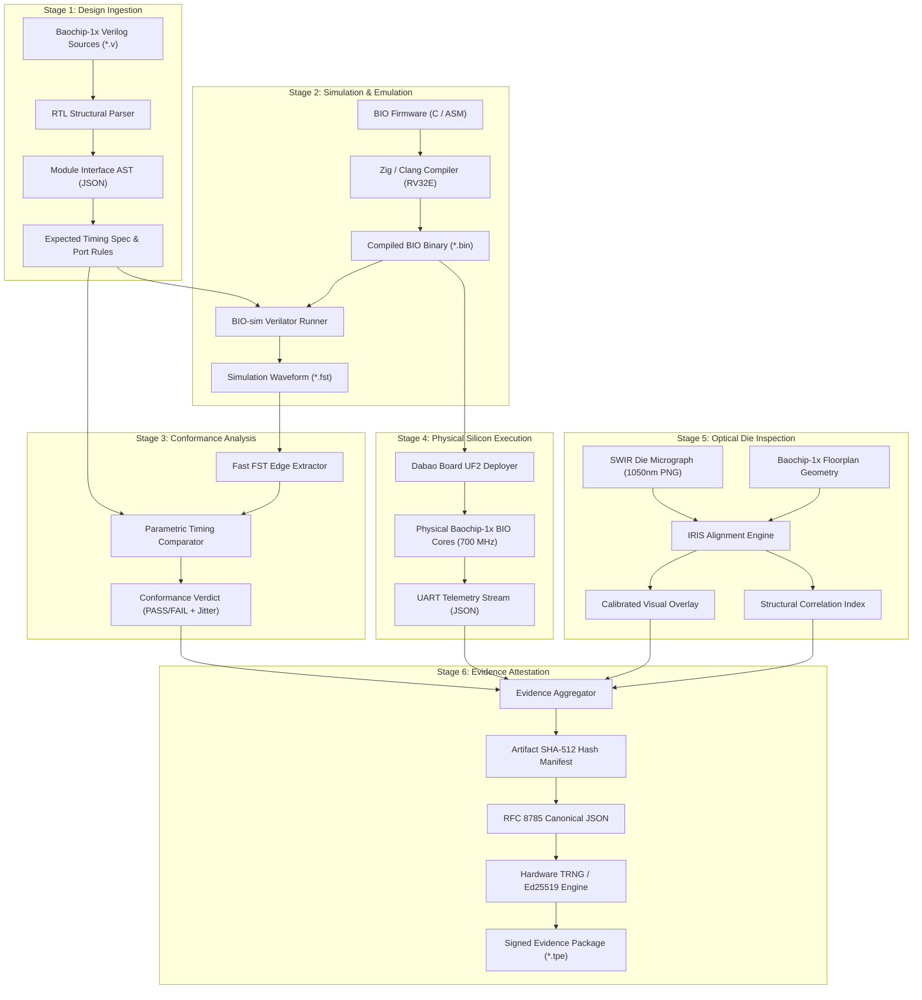

# Architecture — Data Flow & Transformation Pipeline

**Document Reference:** ARCH-DATA-001  
**Project:** TRUSTPRINT  
**Version:** 0.1.0-alpha  

---

## 1. End-to-End Verification Data Pipeline

The data flow connects static source code, simulation artifacts, physical telemetry, optical imagery, and cryptographic certificates:

---

## 2. Data Transformation Formats

1. **RTL Source $\to$ Interface AST:** Unstructured Verilog text is transformed into strongly typed JSON structures defining ports, widths, and clock domains.
2. **C Source $\to$ RV32E Machine Code:** High-level C code is compiled into 32-bit RISC-V embedded instructions with memory-mapped register loads.
3. **Binary FST $\to$ Parametric Edge Events:** Continuous binary waveform signals are parsed into discrete transition timestamps ($t_{rise}, t_{fall}$).
4. **Physical Telemetry $\to$ Statistical Metrics:** Raw cycle counts are transformed into mean period, duty cycle, and peak-to-peak jitter ($\Delta t$).
5. **Raw Micrograph $\to$ Registered Coordinate Canvas:** Pixel coordinates ($u, v$) are converted to chip physical coordinates ($x, y$ in $\mu\text{m}$).
6. **Heterogeneous Evidence $\to$ Canonical Digest:** All verification artifacts are hashed via SHA-512 and signed into a portable `.tpe` certificate.

