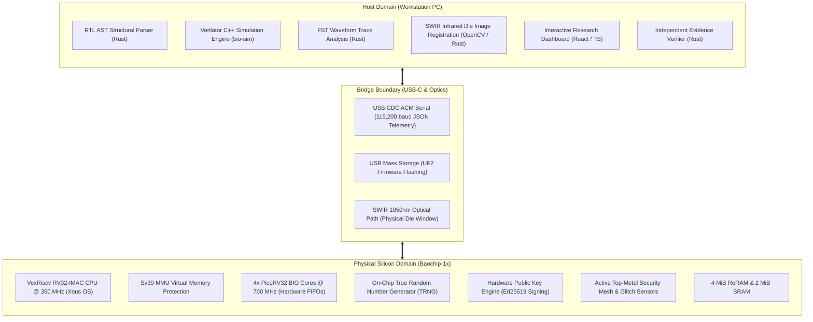

# Architecture — Hardware-Software Boundaries

**Document Reference:** ARCH-BOUND-001  
**Project:** TRUSTPRINT  
**Version:** 0.1.0-alpha  

---

## 1. Domain Separation Matrix

A critical design choice in TRUSTPRINT is where each capability is hosted:

---

## 2. Rationale for Boundary Placement

| Functionality | Assigned Domain | Why Not Other Domain? |
| :--- | :--- | :--- |
| **RTL Parsing** | Host | Parsing large SystemVerilog files requires high RAM (>100 MB) and disk I/O, exceeding Dabao's 2 MiB SRAM. |
| **Waveform Analysis** | Host | FST traces from 100,000 cycles can reach 20–50 MB. Processing is best performed in host memory with 64-bit SIMD math. |
| **High-Speed Probing** | Dabao Silicon | Host USB introduces millisecond-level jitter and latency. Only the on-chip 700 MHz BIO coprocessor can achieve deterministic sub-nanosecond timing. |
| **Cryptographic Root Signing** | Dabao Silicon | Signing must be anchored in the physical chip's hardware TRNG and unextractable private key to guarantee physical provenance. |
| **IRIS Image Registration** | Host | Matrix image transformations and edge filtering are computationally heavy and require floating-point hardware. |
| **Process Memory Isolation** | Dabao Silicon | Hardware Sv39 MMU enforces true memory isolation directly at the CPU bus level. |

