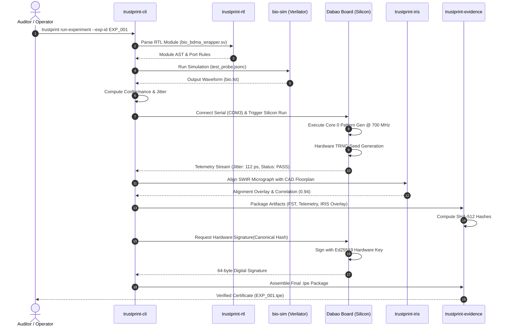
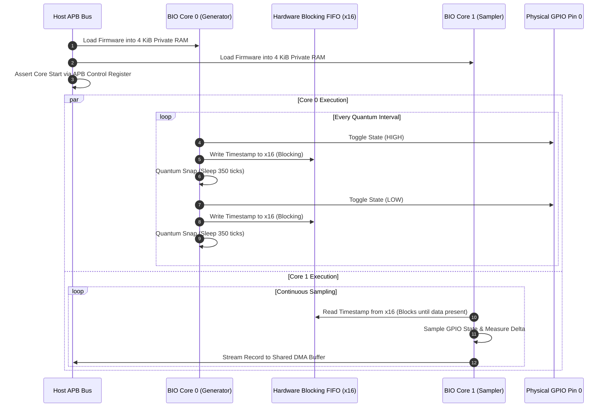

# Architecture — Sequence Diagrams

**Document Reference:** ARCH-SEQ-001  
**Project:** TRUSTPRINT  
**Version:** 0.1.0-alpha  

---

## 1. End-to-End Verification Flow

---

## 2. Multi-Core BIO Synchronization Flow

