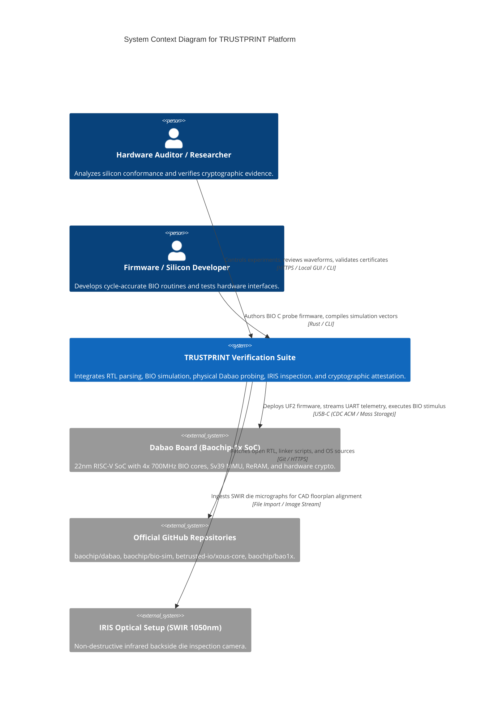

# Architecture — System Context (C4 Model)

**Document Reference:** ARCH-CTX-001  
**Project:** TRUSTPRINT  
**Version:** 0.1.0-alpha  

---

## 1. Context Boundary Diagram

The System Context diagram illustrates how TRUSTPRINT interfaces with external actors, open-source repositories, and the physical silicon target.

---

## 2. External System Interactions

1. **Official GitHub Repositories:** Serves as the upstream source of truth for RTL module definitions, pinouts, and kernel APIs.
2. **Dabao Board Hardware:** The execution environment for high-speed I/O stimulus, memory-isolated testing, and hardware cryptographic key operations.
3. **IRIS Optical Fixture:** Provides raw physical imagery of the exposed silicon die backside for macroscopic geometric validation.
4. **Auditor / Developer:** Interacts with the platform via the command-line harness or web research dashboard.

