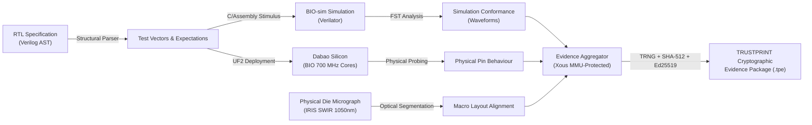

# 00 — Project Overview

## 1. Executive Summary

**TRUSTPRINT** (Open-Silicon Physical Identity and Behaviour Verification Laboratory) is an open-source hardware verification, inspection, and attestation platform tailored for the **Baochip-1x (bao1x)** RISC-V SoC deployed on the **Dabao** evaluation board. 

TRUSTPRINT bridges the chasm between published open-source hardware specifications and physical, observable silicon reality. By leveraging the Baochip-1x's unprecedented architectural affordances—specifically its **4x 700 MHz PicoRV32 BIO coprocessor cores**, **Sv39 MMU-backed Xous operating system**, **on-chip cryptographic accelerators and TRNG**, and **backside-inspectable packaging designed for IRIS (Infra-Red In Situ) optical inspection**—TRUSTPRINT establishes a verifiable, reproducible pipeline connecting:
1. What the RTL designer wrote (source code Verilog).
2. What the silicon simulator models (Verilator / BIO-sim).
3. What the physical pins deterministically output (BIO cycle-accurate bit-banging).
4. What the physical die structure optically reveals (SWIR 1050nm infrared microscopy).
5. What the cryptographic trust anchor cryptographically signs (Ed25519 attestations).

---

## 2. The Core Problem: The Open-Silicon Trust Gap

The semiconductor industry is currently undergoing an open-source revolution reminiscent of the software revolution of the 1990s. Initiatives like RISC-V, OpenLane, SkyWater 130nm, and now the commercially fabricated TSMC 22nm **Baochip-1x** allow developers to inspect silicon source code.

However, **open source silicon introduces an asymmetric verification dilemma**:
- When software is open source, anyone can compile the source code, hash the resulting binary, and verify that the running machine code matches the published repository (reproducible builds).
- When silicon is open source, an end-user receives a black epoxy or wafer-level chip scale package (WLCSP). **How can the user verify that the physical silicon chip contains the open-source RTL and nothing else?**

Traditionally, validating physical chip authenticity required destructive de-packaging, scanning electron microscopy (SEM), focused ion beam (FIB) micro-machining, and multi-million-dollar failure analysis laboratories. For independent developers, security researchers, and high-assurance organizations, this is economically impossible.

Furthermore, traditional microcontroller I/O peripherals (such as standard timers, UARTs, or software-driven GPIOs) suffer from interrupt latency, CPU bus contention, and jitter, making cycle-accurate hardware-in-the-loop behavioral verification unreliable.

---

## 3. The TRUSTPRINT Solution

TRUSTPRINT solves this dilemma by turning the **Dabao development board itself into a self-testing, self-verifying laboratory**, complemented by non-destructive optical die inspection and static RTL analysis.

---

## 4. The 5-Tier Verification Hierarchy

To preserve scientific rigor, TRUSTPRINT divides every assertion into five distinct epistemic tiers:

### Tier 1: Design-Level Verification (RTL Structural Analysis)
- **Mechanism:** Static parsing of Baochip-1x SystemVerilog/Verilog source code.
- **What it Proves:** The documented structural hierarchy, port interfaces, reset states, and memory-mapped register offsets present in the published source repository.
- **What it Cannot Prove:** That the manufactured physical silicon actually embodies this RTL without foundry alterations or physical mask edits.

### Tier 2: Simulation-Level Verification (BIO-sim Cycle-Accurate Emulation)
- **Mechanism:** Software simulation of the `bio_bdma` RTL block inside Verilator driven by C++ testbenches.
- **What it Proves:** That the published Verilog logic behaves deterministically under specific test vectors without timing hazards or state deadlock.
- **What it Cannot Prove:** Real-world physical silicon characteristics, transistor propagation delays across voltage/temperature corners, or physical glitch vulnerability.

### Tier 3: Physical Behavioural Verification (BIO High-Speed Probing)
- **Mechanism:** Deterministic execution across the 4x 700 MHz PicoRV32 BIO cores utilizing hardware blocking FIFOs and snap-to-quantum timing registers.
- **What it Proves:** That the physical silicon pins transition with cycle-accurate determinism matching the simulated timing envelope.
- **What it Cannot Prove:** Complete transistor-level equivalence of all internal, unrouted, or dormant standard cells.

### Tier 4: Physical Die Inspection (IRIS Optical Correlation)
- **Mechanism:** Backside Short-Wave Infrared (~1050nm) microscopy of the exposed silicon substrate.
- **What it Proves:** That macro-scale structures (2 MiB SRAM arrays, 4 MiB ReRAM arrays, CPU clusters, security mesh) physically exist at expected coordinates matching CAD floorplans.
- **What it Cannot Prove:** Sub-micron gate-level netlists or single-transistor logic alterations in lower metal layers.

### Tier 5: Cryptographic Attestation (Hardware-Backed Evidence Authentication)
- **Mechanism:** On-chip SHA-512 hashing and Ed25519 digital signature generation anchored in the Baochip-1x hardware TRNG and secure key store.
- **What it Proves:** That the generated test report was assembled and signed on a specific, authenticated physical Baochip-1x device without post-execution modification.
- **What it Cannot Prove:** That the device's physical environment was unmanipulated prior to execution.

---

## 5. Why the Baochip-1x Silicon is Uniquely Suited

TRUSTPRINT is only possible because of deliberate architectural decisions made by bunnie Huang and the Baochip team:

1. **Design for Inspectability:** The Baochip-1x is packaged in a form factor that preserves optical transparency through the backside substrate, enabling IRIS infrared inspection without destroying the chip.
2. **The BIO Coprocessor:** Unlike Raspberry Pi's state-machine PIO, the BIO coprocessor features four complete RISC-V RV32E cores running at double the CPU clock speed (700 MHz) with hardware blocking FIFOs and quantum snap registers. This provides deterministic I/O capabilities unmatched in commercial microcontrollers.
3. **Sv39 Virtual Memory MMU:** The presence of an MMU on an embedded RISC-V SoC enables **Xous**, allowing full memory isolation between experimental verification workloads and cryptographic attestation roots.
4. **Embedded ReRAM & Hardware Security Domain:** 4 MiB of integrated non-volatile Resistive RAM combined with hardware TRNG, AES, SHA, and an active top-metal security mesh provides tamper-evident key storage.

---

## 6. Project Scope & Hackathon Deliverables

### In-Scope
- Host-side static Verilog structural parser for Baochip-1x modules.
- Cycle-accurate BIO-sim test harness and automated waveform generator.
- Quad-core BIO firmware implementing deterministic pulse generation and logic sampling.
- Waveform transition analysis engine with automated tolerance scoring.
- Physical Dabao deployment scripts with safety-gated flashing protocols.
- IRIS infrared die micrograph alignment and CAD floorplan overlay tool.
- Tamper-evident evidence bundling engine with Ed25519 cryptographic signing.
- Xous microkernel service (`trustprint-srv`) running in Sv39 userland.
- Clean, open-source operator research dashboard (React/TypeScript).

### Explicitly Out-of-Scope
- Transistor-level reverse engineering or automated GDSII netlist extraction.
- Automatic silicon defect localization at nanometer scale.
- Multi-board distributed cluster management or cloud-hosted verification pipelines.
- Proprietary or paid EDA software dependencies (Synopsys, Cadence, Siemens EDA).

