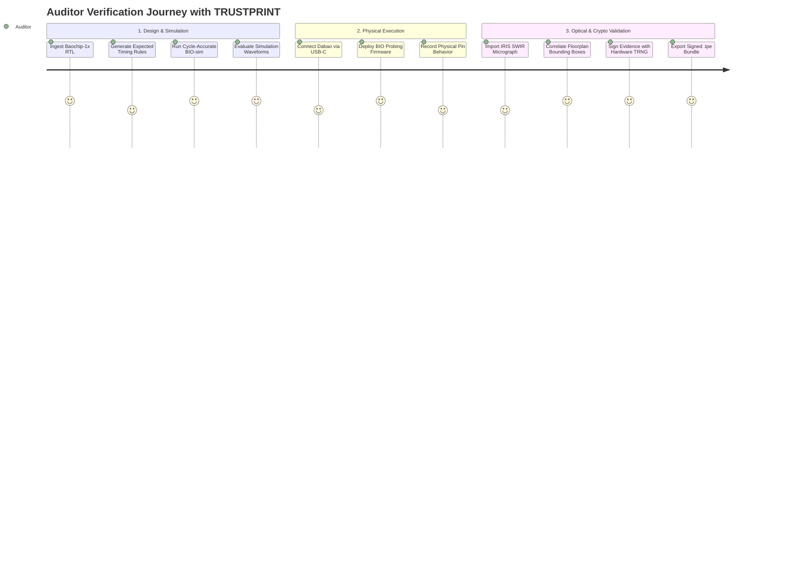

# 01 — Product Requirements Document (PRD)

**Document Reference:** PRD-TRUSTPRINT-2026-V1  
**Project:** TRUSTPRINT (Open-Silicon Physical Identity and Behaviour Verification Laboratory)  
**Target Event:** CrossBar Dabao Open Hardware Hackathon 2026  
**Author:** Sarang Chaudhari (Solo Architect & Engineer)  
**Status:** DRAFT / PENDING OPERATOR FREEZE  

---

## 1. Executive Summary

TRUSTPRINT is an open-source hardware verification and behavioral attestation suite designed specifically for the **Baochip-1x** SoC on the **Dabao** evaluation board. The platform connects published open-source RTL specifications to physical silicon behavior via high-speed BIO coprocessor probing, non-destructive IRIS infrared die inspection, Xous MMU-enforced process isolation, and hardware-anchored cryptographic evidence generation.

---

## 2. Problem Statement & Background

Open-source silicon projects publish their Verilog RTL, but end-users receive physical integrated circuits from commercial semiconductor foundries. Users currently possess no accessible method to verify whether:
1. The physical silicon I/O pins exhibit cycle-accurate timing fidelity matching the open RTL under high frequencies.
2. The internal physical macro-blocks (SRAM, ReRAM, CPU cores, security mesh) physically exist at published coordinates on the die.
3. The experimental evidence gathered during testing is authentic, untampered, and traceable to a specific physical device instance.

TRUSTPRINT solves this by deploying a five-tier verification pipeline directly on the Dabao hardware platform.

---

## 3. Target User Personas

### Persona 1: Dr. Mira Chen — Semiconductor Security Researcher
- **Role:** Senior Academic Researcher specializing in Hardware Trojans and Supply Chain Integrity.
- **Goal:** Investigate whether open-source RISC-V silicon manufactured on commercial nodes (TSMC 22nm) contains unrouted backdoor logic or physical layout discrepancies.
- **Pain Points:** Lack of affordable test fixtures; multi-million dollar FIB/SEM tools are inaccessible for routine verification.
- **Workflow in TRUSTPRINT:** Runs RTL parser against upstream Git repo, deploys BIO probing routines to test boundary state machines, imports IRIS SWIR micrographs to cross-correlate macro floorplans, and exports cryptographically signed evidence bundles for academic publication.

### Persona 2: Kai Nakamura — Embedded Systems & Firmware Engineer
- **Role:** High-Assurance IoT Firmware Developer building on Xous OS.
- **Goal:** Validate that custom communication protocols running on the BIO coprocessor maintain sub-nanosecond jitter tolerance and do not corrupt adjacent memory domains.
- **Pain Points:** Traditional GPIO bit-banging on standard MCUs introduces jitter from OS scheduler preemption; logic analyzer setups require cumbersome external cabling.
- **Workflow in TRUSTPRINT:** Uses `bio-sim` to iterate on multi-core PicoRV32 assembly routines, evaluates FST waveforms, deploys UF2 binaries to Dabao via USB mass storage, and validates Sv39 MMU isolation.

### Persona 3: Alex Osei — Open Hardware Auditor & Policy Advocate
- **Role:** Technical Compliance Auditor for an open-source hardware consortium.
- **Goal:** Provide independent, mathematically verifiable proof that a commercial batch of Dabao boards operates in accordance with their declared open-source specifications.
- **Pain Points:** Vendors make self-attested claims without tamper-evident cryptographic provenance.
- **Workflow in TRUSTPRINT:** Ingests third-party `.tpe` evidence bundles, verifies Ed25519 signatures against verified device public keys, inspects automated conformance matrices, and certifies compliance.

---

## 4. User Journeys

---

## 5. Functional Requirements (FR)

### Subsystem 1: RTL Intelligence Engine (RTL)
- **FR-001:** The system shall parse valid Verilog-2001 and synthesizable SystemVerilog module declarations without third-party proprietary EDA tools.
- **FR-002:** The system shall extract top-level and submodule port lists (port name, direction, bit-width).
- **FR-003:** The system shall extract memory-mapped register definitions, address offsets, and reset values from RTL configuration headers.
- **FR-004:** The system shall identify clock domain boundaries and clock frequency parameters specified in RTL parameters.
- **FR-005:** The system shall generate a structured JSON Abstract Syntax Tree (AST) representing the extracted module interface.
- **FR-006:** The system shall automatically derive baseline stimulus-response test vectors from parsed port interfaces.

### Subsystem 2: BIO Experimentation Engine (BIO)
- **FR-007:** The system shall support compilation of BIO firmware written in C (via Zig/Clang) and RV32E assembly.
- **FR-008:** The system shall support execution of BIO firmware inside the `baochip/bio-sim` Verilator simulator.
- **FR-009:** The system shall configure and coordinate all four independent 700 MHz PicoRV32 BIO cores.
- **FR-010:** The system shall utilize hardware blocking FIFO registers (`x16`–`x31`) for inter-core communication without manual software spinlocks.
- **FR-011:** The system shall utilize the BIO "snap to quantum" timing register to align I/O pin transitions to exact clock boundaries.
- **FR-012:** The system shall generate deterministic pulse-width-modulation (PWM) and serial bit-stream patterns on designated GPIO pins.
- **FR-013:** The system shall capture high-speed input state transitions on designated GPIO pins with cycle-accurate timestamping.
- **FR-014:** The system shall deploy compiled BIO binaries to the physical Dabao board via USB/UART or Xous loader services.

### Subsystem 3: Waveform & Conformance Engine (WAV)
- **FR-015:** The system shall parse `.fst` (Fast Signal Trace) and `.vcd` (Value Change Dump) waveform files produced by `bio-sim`.
- **FR-016:** The system shall extract signal transition timestamps for designated probe nets.
- **FR-017:** The system shall compute signal duty cycle, period, frequency, and rise/fall intervals from waveform data.
- **FR-018:** The system shall compare observed physical or simulated transition edges against expected timing tolerances defined in the test configuration.
- **FR-019:** The system shall generate a Conformance Verdict (PASS, FAIL, INCONCLUSIVE) accompanied by jitter and delta metrics.
- **FR-020:** The system shall render digital waveform plots for visual inspection within the operator interface.

### Subsystem 4: IRIS Optical Die Inspection Engine (IRIS)
- **FR-021:** The system shall import high-resolution infrared (SWIR ~1050nm) die micrographs in standard formats (PNG, TIFF, JPEG).
- **FR-022:** The system shall calibrate pixel-to-micrometer scale based on physical chip dimensions (Baochip-1x die size).
- **FR-023:** The system shall store inspection session metadata (magnification, optical wavelength, illumination angle, timestamp).
- **FR-024:** The system shall support manual and semi-automated annotation of macroscopic physical silicon features (2 MiB SRAM array, 4 MiB ReRAM tile, CPU clusters, security mesh perimeter).
- **FR-025:** The system shall overlay published CAD floorplan bounding boxes onto aligned IRIS micrographs.
- **FR-026:** The system shall compute structural correlation scores between expected CAD geometry and segmented optical features.

### Subsystem 5: Cryptographic Evidence Engine (CRYPTO)
- **FR-027:** The system shall aggregate experiment metadata, RTL hashes, simulation logs, waveform metrics, and IRIS inspection data into a canonical JSON evidence bundle (`.tpe`).
- **FR-028:** The system shall compute cryptographic SHA-512 hashes for all external artifact files referenced by the evidence bundle.
- **FR-029:** The system shall generate an Ed25519 digital signature over the canonical evidence bundle using the Baochip-1x hardware TRNG and private key store.
- **FR-030:** The system shall provide a software fallback signing mechanism for host-based development and simulation testing, with explicit metadata labelling (`signer_method: "SOFTWARE_DEVELOPMENT_KEY"`).
- **FR-031:** The system shall independently verify `.tpe` evidence signatures and hash integrity on host workstations without connected hardware.

### Subsystem 6: Xous Microkernel & MMU Isolation (XOUS)
- **FR-032:** The system shall deploy the verification coordinator as an isolated userland service (`trustprint-srv`) under Xous OS.
- **FR-033:** The system shall enforce hardware-backed Sv39 virtual memory isolation preventing experimental code from reading or writing cryptographic key memory.
- **FR-034:** The system shall communicate with other Xous services (TRNG, TickTimer, PDDB) using strongly-typed Xous IPC message protocols.
- **FR-035:** The system shall store persistent verification records within the Plausibly Deniable DataBase (PDDB).

---

## 6. Non-Functional Requirements (NFR)

### Epistemic Integrity & Truth in Advertising
- **NFR-001 (Distinction of Tiers):** Every report, output, and UI view shall explicitly label data provenance as either `DESIGN_RTL`, `SIMULATION_VERILATOR`, `PHYSICAL_IO_BEHAVIOURAL`, `OPTICAL_IRIS`, or `CRYPTOGRAPHIC_ATTESTATION`.
- **NFR-002 (No False Equivalence):** The system shall never present software or I/O experiments as proof of complete transistor-level physical equivalence.
- **NFR-003 (Zero Data Fabrication):** The system shall never generate synthetic hardware measurements presented as physical silicon data. When running in mock or simulation mode, all outputs shall be explicitly labelled `SIMULATED_MOCK_DATA`.

### Performance & Timing Targets
- **NFR-004:** The host-side RTL parser shall parse a 10,000-line Verilog source file in under 2.0 seconds on a standard modern PC.
- **NFR-005:** The `bio-sim` simulation testbench for standard 1,000-cycle GPIO experiments shall complete in under 5.0 seconds.
- **NFR-006:** The BIO coprocessor stimulus routines shall achieve hard deterministic cycle-accuracy at 700 MHz (1.428 ns clock period) using the quantum snap mechanism.
- **NFR-007:** Canonical hashing and signing of a complete evidence package shall complete in under 200 ms.

### Safety & Hardware Protection
- **NFR-008 (Safety Gate):** The system shall never flash firmware, write to non-volatile ReRAM security regions, or blow one-way hardware counters without explicit operator confirmation.
- **NFR-009 (No Secret Exposure):** Private cryptographic signing keys and hardware seeds shall never appear in console logs, serial debug streams, or unencrypted evidence fields.

### Portability & Openness
- **NFR-010:** All software components shall compile using free, open-source toolchains (Rust, GCC/Clang, Zig, Verilator, Python).
- **NFR-011:** Host-side tools shall operate deterministically on Linux, macOS, and Windows.
- **NFR-012:** All project source code, documentation, and hardware configurations shall be published under the permissive MIT License.

---

## 7. Hardware Requirements (HR)

- **HR-001:** Target hardware shall be the **Dabao evaluation board** featuring the **Baochip-1x (bao1x)** SoC.
- **HR-002:** The system shall support USB-C High-Speed interconnect for power, firmware deployment, and serial communication.
- **HR-003:** The system shall utilize the onboard 4 MiB non-volatile ReRAM for program storage.
- **HR-004:** The system shall utilize the onboard 2 MiB integrated SRAM for volatile execution memory.
- **HR-005:** The system shall interact with the 4x 700 MHz PicoRV32 BIO coprocessor cores via memory-mapped I/O registers.
- **HR-006:** The system shall interface with the on-chip True Random Number Generator (TRNG) for cryptographic entropy.
- **HR-007:** The system shall support optical inspection through the backside silicon substrate using short-wave infrared illumination (~1050 nm).
- **HR-008:** The system shall accommodate 3.3V / 1.8V GPIO voltage levels on exposed Dabao header pins.

---

## 8. Software Requirements (SR)

- **SR-001:** Rust compiler toolchain: `stable` (1.75+) and `nightly` with `riscv32imac-unknown-none-elf` and `riscv32imac-unknown-xous-elf` targets.
- **SR-002:** Xous operating system source tree: `betrusted-io/xous-core` built via `cargo xtask`.
- **SR-003:** Verilator EDA simulator version 5.0 or later.
- **SR-004:** Zig compiler version 0.12+ (providing Clang/LLVM RV32E embedded support).
- **SR-005:** Python 3.11+ with packages: `pyserial`, `cbor2`, `cryptography`, `matplotlib`, `numpy`.
- **SR-006:** Waveform analysis tool: GTKWave 3.3+ or Surfer.
- **SR-007:** Node.js 18+ and pnpm/npm for the operator dashboard interface.

---

## 9. Feature Prioritization (MoSCoW Matrix)

| Feature | Category | Priority | Rationale for Hackathon |
| :--- | :--- | :--- | :--- |
| **BIO-sim Simulation & Waveform Generation** | Simulation | **Must Have (P0)** | Foundation for testing without risk to physical hardware. |
| **Deterministic BIO GPIO Probing Firmware** | Silicon I/O | **Must Have (P0)** | Core showcase of Baochip-1x 700 MHz coprocessor capability. |
| **Physical Dabao Board Execution** | Hardware | **Must Have (P0)** | Essential for "Works" judging criterion. |
| **Tamper-Evident Evidence Signing (.tpe)** | Crypto | **Must Have (P0)** | Delivers the "Authenticate the evidence" core mission. |
| **RTL Structural Port Parser** | RTL | **Should Have (P1)** | Connects published RTL to physical experiment configuration. |
| **IRIS Die Image Alignment & Overlay** | Inspection | **Should Have (P1)** | Showcases Baochip-1x unique inspectable packaging. |
| **Xous MMU Isolation Service** | OS / Security | **Should Have (P1)** | Demonstrates high-assurance OS capabilities on open silicon. |
| **Operator Research Dashboard (Web/GUI)** | UI / UX | **Could Have (P2)** | Enhances demo video and usability for judges. |
| **Automated FPGA Emulation Harness** | Hardware | **Won't Have (P3)** | Out of scope for Dabao hackathon deadline. |
| **Transistor-Level Gate Reconstruction** | Research | **Won't Have (P3)** | Mathematically impossible with optical tools alone. |

---

## 10. Acceptance Criteria per Subsystem

### AC-1: BIO-sim Verification
- **Scenario:** Verifying BIO Core 0 GPIO toggle routine.
- **Given:** A valid BIO assembly/C routine compiled into binary.
- **When:** Executed inside `bio-sim` with `configs/hello-world.jsonc`.
- **Then:** Simulation completes with exit code 0, outputs `waveform/bio.fst`, and GTKWave displays periodic state transitions on output net `gpio_out[0]`.

### AC-2: RTL Port Extraction
- **Scenario:** Parsing Baochip-1x UART controller module.
- **Given:** `uart.v` source file.
- **When:** Ingested by `trustprint-rtl` parser.
- **Then:** Parser outputs JSON AST containing ports `clk`, `rst_n`, `tx`, `rx` with exact bit-widths matching the source code.

### AC-3: Physical Silicon Execution
- **Scenario:** Running BIO probe routine on physical Dabao board.
- **Given:** Board connected via USB-C and flashed with `apps.uf2`.
- **When:** Firmware boots and starts `trustprint-srv`.
- **Then:** UART console emits `[TRUSTPRINT] BIO Cores 0-3 initialized @ 700 MHz`, and GPIO pin 0 emits square wave verified by logic probe.

### AC-4: Cryptographic Evidence Attestation
- **Scenario:** Creating and verifying an evidence certificate.
- **Given:** A completed experiment with waveform and log artifacts.
- **When:** `trustprint-evidence` generates a `.tpe` bundle.
- **Then:** The bundle includes SHA-512 hashes of all inputs, a valid Ed25519 signature, and independent verification on a host returns `STATUS: VALID`.

---

## 11. Success Metrics for Hackathon Submission
1. **Live Demonstration:** A fully functional, uninterrupted 5-minute video demonstrating the complete pipeline from RTL parsing to physical Dabao execution and signed report generation.
2. **Open-Source Reproducibility:** Any judge with a Dabao board and a standard Linux/macOS/Windows laptop can clone the repo and reproduce the simulation and hardware results within 3 commands.
3. **Silicon Utilization:** Demonstrates deep usage of Baochip-1x unique silicon features (4x BIO cores, quantum snap, hardware crypto, MMU isolation, IRIS optical compatibility).

