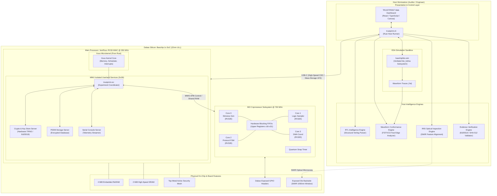
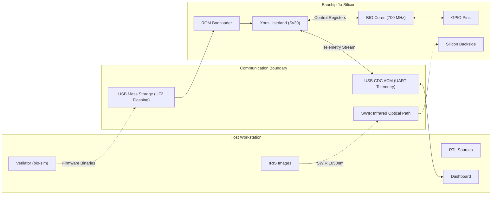

# 02 — System Architecture

**Document Reference:** ARCH-SYS-001  
**Project:** TRUSTPRINT  
**Version:** 0.1.0-alpha  

---

## 1. Architectural Philosophy

TRUSTPRINT is designed around the principle of **co-verification across heterogeneous domains**: bridging high-level software abstractions, microkernel OS process isolation, cycle-accurate simulation, physical silicon coprocessor execution, and optical physics.

The architecture strictly decouples:
- **Host Tools (Workstation Domain):** Responsible for parsing RTL, managing simulation jobs, analyzing waveforms, processing IRIS optical images, and rendering the operator interface.
- **Embedded System (Dabao Silicon Domain):** Responsible for executing cycle-accurate pin stimulus across 4x 700 MHz BIO cores, maintaining high-assurance memory isolation via Xous and Sv39 MMU, and anchoring evidence in on-chip hardware cryptography (TRNG, SHA, PKE).

---

## 2. High-Level System Architecture

---

## 3. Subsystem Decomposition

### 1. RTL Intelligence Engine (`trustprint-rtl`)
- **Role:** Parses published open-source Baochip-1x Verilog source files.
- **Inputs:** Verilog source trees (`bao1x/rtl/*.v`), module parameter headers.
- **Outputs:** Module interface JSON AST, signal name maps, clock frequency definitions, expected register address maps.
- **Execution Domain:** Host workstation (Rust / Python).

### 2. BIO Simulation Engine (`trustprint-sim`)
- **Role:** Provides a software-safe test harness for cycle-accurate stimulus and response verification prior to silicon deployment.
- **Inputs:** BIO firmware binaries (`.bin`), simulation configuration scripts (`.jsonc`).
- **Outputs:** Cycle-accurate `.fst` waveforms, execution trace logs, core register dumps.
- **Execution Domain:** Host workstation (Verilator C++ executable).

### 3. BIO Silicon Experiment Engine (`trustprint-bio`)
- **Role:** Drives physical pin stimulus and real-time logic analysis directly on the Baochip-1x silicon.
- **Architecture:** Quad-core PicoRV32 (RV32E) cluster clocked at 700 MHz (2x CPU clock).
  - Uses upper registers (`x16`–`x31`) as hardware blocking queues for zero-overhead inter-core synchronization.
  - Uses the "snap to quantum" register to align edge transitions precisely to clock quanta, eliminating instruction-timing jitter.
- **Execution Domain:** Dabao BIO coprocessor cores.

### 4. Waveform & Conformance Engine (`trustprint-waveform`)
- **Role:** Ingests simulation or physical logic capture traces, measures signal properties, and checks conformance against RTL specifications.
- **Metrics:** Clock period, duty cycle, transition rise/fall intervals, edge-to-edge jitter.
- **Verdict Logic:** PASS (within $\pm$ 2% tolerance), FAIL (out of envelope), INCONCLUSIVE (missing edge events).
- **Execution Domain:** Host workstation.

### 5. IRIS Optical Inspection Engine (`trustprint-iris`)
- **Role:** Bridges macro-scale physical die layout with CAD floorplan blueprints.
- **Mechanism:** Ingests Short-Wave Infrared (~1050nm) micrographs of the Baochip-1x exposed backside die. Segments boundaries of major physical features (SRAM banks, ReRAM blocks, VexRiscv core, BIO cluster, security mesh perimeter).
- **Outputs:** Calibrated visual overlay and structural correlation index.
- **Execution Domain:** Host workstation.

### 6. Cryptographic Evidence & Attestation Engine (`trustprint-evidence`)
- **Role:** Creates tamper-evident, verifiable proof bundles of all verification activities.
- **Mechanism:** Aggregates experiment parameters, hashes external artifacts (RTL, firmware, waveforms, IRIS images) with SHA-512, and cryptographically signs the canonical bundle with Ed25519.
- **Execution Domain:** Dabao hardware crypto domain (production) or host development key (testing fallback).

### 7. Xous Microkernel & Process Isolation Layer (`trustprint-srv`)
- **Role:** Manages the lifecycle of verification routines on the Dabao board while enforcing strict memory protection.
- **Architecture:** Pure-Rust capability-based microkernel with Sv39 virtual memory. Isolates test coordination logic from cryptographic key stores, preventing arbitrary test vectors from compromising system root keys.
- **Execution Domain:** Dabao VexRiscv 350 MHz CPU under Xous OS.

### 8. Operator Research Dashboard (`trustprint-dashboard`)
- **Role:** Provides an intuitive graphical control center for researchers, auditors, and hackathon evaluators.
- **Features:** Real-time hardware telemetry, live serial log viewer, interactive waveform trace display, optical IRIS image comparison viewer, and cryptographic certificate verifier.
- **Execution Domain:** Host workstation browser (React / TypeScript).

---

## 4. Hardware-Software Boundaries

---

## 5. Security & Isolation Architecture

The system enforces three concentric rings of trust:
1. **Ring 0: Silicon Hardware Security Subsystem**
   - Active top-metal security mesh (monitors physical tampering/microprobing).
   - Glitch sensors (monitors voltage and clock anomalies).
   - Hardware True Random Number Generator (TRNG) and secure key storage.
2. **Ring 1: Xous Microkernel & Sv39 MMU**
   - Strictly isolated virtual address spaces per userland server.
   - Capability-based message routing.
   - Memory-mapped I/O is restricted exclusively to authorized driver processes.
3. **Ring 2: Experimental Userland (`trustprint-srv`)**
   - Coordinates experiment execution, triggers BIO routines, and streams telemetry.
   - Completely isolated from master cryptographic key storage.

