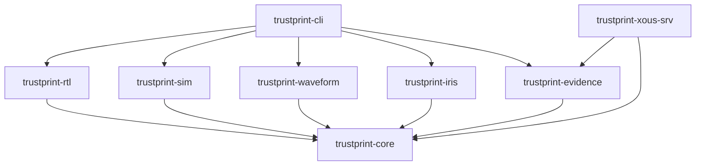
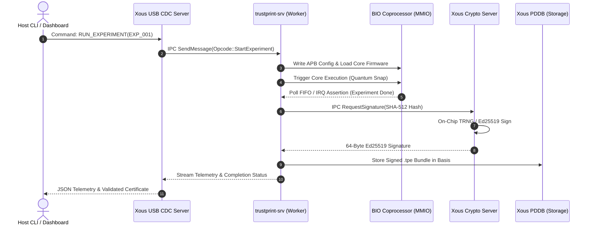
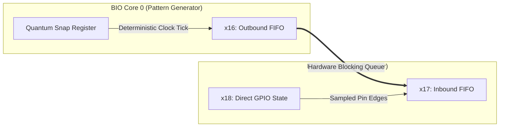
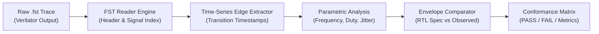

# 03 — Technical Architecture

**Document Reference:** ARCH-TECH-001  
**Project:** TRUSTPRINT  
**Version:** 0.1.0-alpha  

---

## 1. Rust Workspace & Crate Hierarchy

TRUSTPRINT is organized as a modular Cargo workspace decoupling host-side analysis, embedded firmware, communication protocols, and cryptographic schemas:

```
TRUSTPRINT/
├── Cargo.toml                       # Workspace manifest
├── crates/
│   ├── trustprint-core/             # Shared types, error definitions, epistemic enums
│   ├── trustprint-rtl/              # Static structural Verilog parser & AST generator
│   ├── trustprint-sim/              # bio-sim orchestration & FST waveform reader
│   ├── trustprint-waveform/         # Conformance & timing edge comparator
│   ├── trustprint-iris/             # SWIR optical micrograph alignment & CAD overlay
│   ├── trustprint-evidence/         # Canonical JSON serialization & Ed25519 signing
│   ├── trustprint-cli/              # Host command-line runner and pipeline harness
│   └── trustprint-xous-srv/         # Userland Xous microkernel service (Dabao target)
├── bio/                             # BIO coprocessor firmware (C and RV32E assembly)
│   ├── src/                         # Probing routines (quantum snap, blocking FIFO)
│   └── build.zig                    # Zig build configuration for PicoRV32
├── firmware/                        # Xous application and xtask deployment scripts
├── dashboard/                       # React + TypeScript operator interface
└── evidence/                        # Signed .tpe evidence output directory
```

### Dependency Matrix


---

## 2. Xous Microkernel Server Architecture

In the Xous operating system, services run as isolated userland processes communicating strictly via IPC messages (opcodes, scalar values, and borrowed memory blocks).

### Server Registration & IPC Flow
The `trustprint-srv` server registers a public connection name (e.g., `_TrustPrint Verification Service_`) with the Xous name server (`xous-names`).



### IPC Opcode Definitions (`trustprint-xous-srv`)
```rust
#[derive(Debug, num_derive::FromPrimitive, num_derive::ToPrimitive)]
pub enum Opcode {
    /// Ping service and verify memory isolation status
    Status = 0,
    /// Configure designated BIO core with parameter block
    ConfigureBioCore = 1,
    /// Load compiled bytecode into BIO private RAM (4 KiB)
    LoadBioProgram = 2,
    /// Start synchronized multi-core execution
    StartExecution = 3,
    /// Read captured logic transition buffer
    ReadCaptureBuffer = 4,
    /// Request cryptographic attestation of completed run
    SignEvidence = 5,
    /// Abort running experiment and reset BIO subsystem
    Abort = 6,
}
```

---

## 3. BIO Coprocessor Execution Model

The BIO subsystem comprises four independent **PicoRV32** cores implementing the **RV32E** (embedded integer, 16 general-purpose registers `x0`–`x15`) instruction set, clocked at **700 MHz** (double the 350 MHz CPU clock).

### Direct Register Mapping & Blocking FIFOs
The upper register bank (`x16` through `x31`) is directly wired to hardware peripherals and inter-core FIFOs:
- Reading from an empty FIFO register **automatically halts the PicoRV32 core** until data is written by another core or the host APB bus.
- Writing to a full FIFO register **automatically halts the core** until downstream space is cleared.
- This provides zero-overhead hardware synchronization without polling loops, preventing race conditions.



### The "Snap to Quantum" Mechanism
To ensure jitter-free timing without fragile assembly cycle counting:
1. The BIO hardware provides a dedicated quantum timer counter running at 700 MHz.
2. A special register write to the quantum snap address causes the PicoRV32 core to sleep until the next exact quantum tick.
3. Upon wakeup, the next instruction executes on the exact clock edge, ensuring sub-nanosecond edge determinism.

---

## 4. Cryptographic Evidence Schema (`.tpe`)

All verification activities culminate in a canonical, self-describing, cryptographically signed JSON evidence record:

```json
{
  "$schema": "https://trustprint.org/schemas/v1/evidence.json",
  "trustprint_version": "0.1.0-alpha",
  "record_id": "TPE-20261112-0042",
  "timestamp_utc": "2026-11-12T18:45:00Z",
  "epistemic_tier": "PHYSICAL_IO_BEHAVIOURAL",
  
  "target_hardware": {
    "soc_part": "BAO1X2S4F-WA",
    "soc_name": "Baochip-1x",
    "process_node": "TSMC 22nm ULL",
    "board_model": "Dabao v3c",
    "device_dna_sha256": "8f434346648f6b96df89dda901c5176b10a6d83961dd3c1ac88b59b2dc327aa4",
    "security_mesh_intact": true,
    "glitch_counter": 0
  },

  "experiment_manifest": {
    "name": "bio_gpio_deterministic_pulse",
    "target_core": 0,
    "clock_freq_hz": 700000000,
    "quantum_ticks_per_cycle": 350,
    "expected_period_ns": 500.0,
    "expected_duty_cycle_percent": 50.0
  },

  "artifacts": [
    {
      "name": "firmware_binary",
      "uri": "bio/bin/pulse_gen.bin",
      "sha512": "cf83e1357eefb8bdf1542850d66d8007d620e4050b5715dc83f4a921d36ce9ce47d0d13c5d85f2b0ff8318d2877eec2f63b931bd47417a81a538327af927da3e"
    },
    {
      "name": "simulation_waveform",
      "uri": "waveform/bio_sim_expected.fst",
      "sha512": "5c6f95066a3d6f14b620b7...[truncated]..."
    },
    {
      "name": "iris_die_micrograph",
      "uri": "inspection/swir_die_macro_1050nm.png",
      "sha512": "9a01b2c3d4...[truncated]..."
    }
  ],

  "conformance_result": {
    "verdict": "PASS",
    "observed_period_mean_ns": 499.988,
    "observed_jitter_p2p_ps": 112,
    "tolerance_window_percent": 2.0,
    "notes": "Silicon behavior conforms to RTL timing envelope within acceptable thermal jitter bounds."
  },

  "cryptographic_attestation": {
    "signing_authority": "DABAO_ONCHIP_SECURITY_SUBSYSTEM",
    "signing_algorithm": "Ed25519-SHA-512",
    "signer_public_key_hex": "4f5355424558414d504c45...[32 bytes]...",
    "signature_hex": "e7b0c39a8f...[64 bytes]...",
    "canonical_payload_sha512": "b109f3bbbc244eb82441917ed06d618b9008dd09b3befd1b5e07394c706a8bb980b1d7785e5976ec049b46df5f1326af5a2ea6d103fd07c95385ffab0cacbc86"
  }
}
```

---

## 5. Waveform Processing Pipeline



The waveform parser processes signal transitions in streaming chunks:
1. **Index Signal Table:** Extracts signal paths (e.g., `TOP.bio_bdma_wrapper.bio.core0_gpio_out[0]`).
2. **Epoch Extraction:** Converts variable-rate time steps into fixed timestamp epochs (1 ps resolution).
3. **Transition Detection:** Records rising ($0 \to 1$) and falling ($1 \to 0$) edge timestamps.
4. **Statistical Jitter Measurement:** Computes peak-to-peak and RMS jitter across $N=10,000$ simulated or captured cycles.

