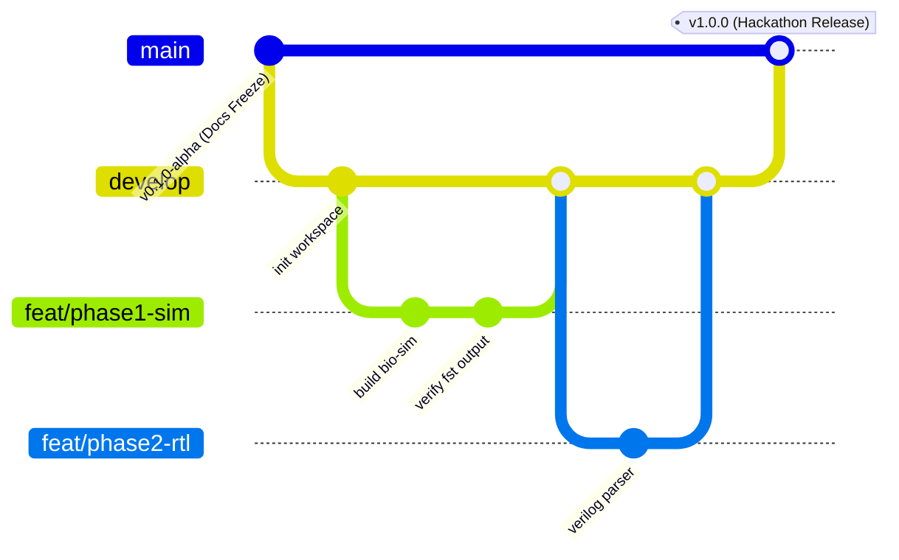

# 06 — Solo Developer Workflow & Operational Protocol

**Document Reference:** WORKFLOW-SOLO-001  
**Project:** TRUSTPRINT  
**Version:** 0.1.0-alpha  

---

## 1. Operating Principles for a Solo Researcher

Developing an advanced hardware-software verification platform as an individual researcher within a tight deadline (~30 days) requires extreme discipline, systematic risk management, and structured execution.

### The 5 Non-Negotiable Solo Developer Rules
1. **Never Jump Ahead of Verification:** Never flash firmware to physical hardware without first verifying execution inside `bio-sim`.
2. **One Logical Change per Commit:** Keep atomic commits. When debugging low-level timing or MMIO registers, bisectability is critical.
3. **No Flashing Without a Recovery Plan:** Ensure you know how to re-enter bootloader mode (`PROG` button sequence) before writing non-volatile memory.
4. **Synchronize Documentation in Real-Time:** If an API changes during implementation, update the corresponding `docs/` specification in the same commit.
5. **Protect Hardware Security Fuses:** Never execute self-built firmware that touches one-way silicon fuses, developer mode locks, or factory root-of-trust registers without explicit operator authorization.

---

## 2. Git Branching & Release Strategy



- **`main`:** Production-grade, verified releases. Only merged when end-to-end tests pass.
- **`develop`:** Integration branch for completed phases.
- **`feat/phaseX-*`:** Focused topic branches for each implementation phase.

---

## 3. Daily Execution Workflow

### Step 1: Pre-Work Orientation
1. Read `planning/current-phase.md` to identify active tasks.
2. Review `planning/task-backlog.md` for dependencies.
3. Verify local environment and branch status:
   ```bash
   git status
   git branch
   ```

### Step 2: Implementation & Incremental Testing
1. Implement code within the specific crate or directory.
2. Run unit tests immediately:
   ```bash
   cargo test --all-targets
   ```
3. Run simulation regression if BIO firmware is touched:
   ```bash
   ./scripts/run_simulation.sh
   ```

### Step 3: Hardware Verification (When In Hardware Phases)
1. Verify safety checklist before inserting USB-C cable.
2. Build binary:
   ```bash
   cargo xtask dabao trustprint-srv
   ```
3. Flash device via USB Mass Storage mode.
4. Monitor serial telemetry:
   ```bash
   python scripts/serial_telemetry.py --port COM3
   ```

### Step 4: End-of-Day Documentation & Logging
1. Update `planning/progress-log.md` with accomplishments and any unexpected hardware anomalies.
2. Update `CHANGELOG.md` if public APIs or data structures changed.
3. Commit with a structured Conventional Commit message:
   ```bash
   git add -A
   git commit -m "feat(bio): implement quantum snap delay loop with zero jitter"
   ```

---

## 4. Hardware Safety Checklist (Mandatory Pre-Flashing Review)

Before flashing ANY image to the Dabao board:
- [ ] Has this exact code been compiled and executed in `bio-sim` without infinite loops or memory faults?
- [ ] Are any writes directed to non-volatile ReRAM security regions or OTP (One-Time Programmable) fuses? *(Answer MUST be NO)*.
- [ ] Is the USB cable securely seated to prevent power interruption during flash write?
- [ ] Is the target UF2 file generated from the trusted build pipeline?
- [ ] Is serial console logging active to capture boot output?

