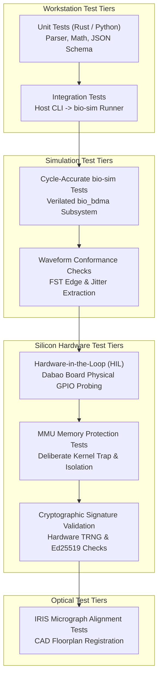

# 08 — Master Testing & Quality Assurance Strategy

**Document Reference:** TEST-STRAT-001  
**Project:** TRUSTPRINT  
**Version:** 0.1.0-alpha  

---

## 1. Testing Philosophy

In an open-silicon research project, testing cannot be an afterthought. The integrity of TRUSTPRINT rests entirely on reproducibility, statistical rigor, and clear separation between simulated and physical behaviors.

### The Four Tenets of TRUSTPRINT Verification
1. **Never Skip Failed Tests Silently:** Every failed assertion must log raw state, signal epochs, and error registers.
2. **Explicit Environmental Labelling:** Every test record must state whether it executed in `SIMULATION_VERILATOR`, `PHYSICAL_SILICON`, or `HOST_MOCK`.
3. **Traceability:** Every test vector maps back to a specific Functional Requirement (FR) from the PRD (`docs/01-PRD.md`).
4. **Reproducible Test Bundles:** All test inputs, seeds, firmware binaries, and waveform traces are archived alongside test verdicts.

---

## 2. Test Classification Matrix



---

## 3. Detailed Test Levels

### Level 1: Unit Testing (`trustprint-*` Crates)
- **Scope:** Pure software logic: Verilog AST parsing, JSON schema validation, mathematical jitter computations, cryptographic hashing.
- **Execution:** Automated via `cargo test --all-targets`.
- **Target Coverage:** $\ge 85\%$ line coverage across `trustprint-core`, `trustprint-rtl`, `trustprint-waveform`, and `trustprint-evidence`.

### Level 2: BIO-sim Cycle-Accurate Simulation Testing
- **Scope:** Multi-core PicoRV32 execution, blocking FIFO synchronization, quantum snap alignment, APB bus register transactions.
- **Tools:** Verilator 5.0+, C++ simulation harness (`sim_main.cpp`).
- **Acceptance Criteria:** Zero FIFO deadlock states, zero dropped bus transactions, deterministic cycle count across repeated runs with identical seeds.

### Level 3: Waveform Conformance Testing
- **Scope:** Validates that generated waveforms match expected timing rules derived from RTL parameters.
- **Metrics Evaluated:**
  - Clock frequency ($f = \frac{1}{T}$)
  - Duty cycle ($\frac{T_{high}}{T} \times 100\%$)
  - Transition edge jitter ($\Delta t_{edge}$)
- **Pass Threshold:** Observed parameters within $\pm 2.0\%$ of theoretical model.

### Level 4: Hardware-in-the-Loop (HIL) Physical Testing
- **Scope:** Execution of compiled BIO firmware on physical Dabao board silicon.
- **Metrics Evaluated:**
  - Bootloader enumeration and UF2 flash integrity.
  - UART telemetry streaming stability at 115,200 baud.
  - Physical GPIO pin transitions observed across 10,000 continuous cycles.

### Level 5: Security & MMU Isolation Testing
- **Scope:** Verifies that Xous microkernel memory protection prevents unauthorized cross-process access.
- **Test Case SEC-001 (Unauthorized MMIO Access):** Test process attempts to read hardware cryptographic key registers directly without kernel capability tokens.
  - *Expected Result:* RISC-V hardware illegal instruction or page fault trap; process terminated; kernel remains running.

### Level 6: Cryptographic Attestation Verification Testing
- **Scope:** Validates that generated `.tpe` evidence packages can be verified on an independent host machine without access to the Dabao board.
- **Acceptance Criteria:**
  - 100% SHA-512 artifact hash match.
  - Ed25519 public key correctly authenticates signature over canonical JSON.

---

## 4. Test Reporting Standards

Every test execution emits a structured test report:

```json
{
  "test_id": "TEST-BIO-SIM-001",
  "requirement_id": "FR-010",
  "environment": "SIMULATION_VERILATOR",
  "seed": 42,
  "cycles_simulated": 10000,
  "verdict": "PASS",
  "measurements": {
    "expected_period_ns": 500.0,
    "observed_period_mean_ns": 499.988,
    "jitter_peak_to_peak_ps": 112
  },
  "artifacts": [
    {
      "name": "waveform",
      "uri": "waveform/bio.fst",
      "sha512": "..."
    }
  ]
}
```

