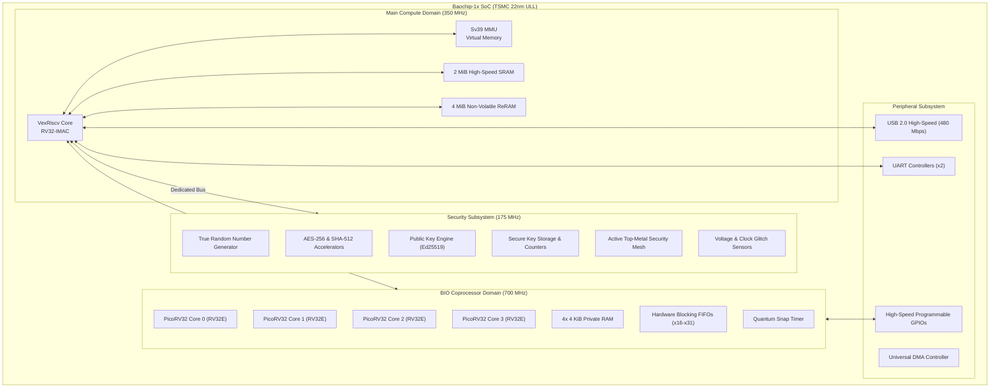

# 09 — Hardware Integration & Dabao Specifications

**Document Reference:** HW-INTEG-001  
**Project:** TRUSTPRINT  
**Version:** 0.1.0-alpha  

---

## 1. Baochip-1x SoC Hardware Architecture

The **Baochip-1x** (part number `BAO1X2S4F-WA`) is a commercial-grade, open-source RISC-V System-on-Chip fabricated on **TSMC’s 22nm ULL (Ultra-Low Leakage)** process.

---

## 2. Silicon Memory Architecture

### A. Integrated 2 MiB SRAM
- **Organization:** High-speed, zero-wait-state volatile memory.
- **Address Space:** `0x4000_0000` – `0x401F_FFFF`.
- **Usage in TRUSTPRINT:** Xous microkernel page tables, userland heaps, and active verification buffers.

### B. Integrated 4 MiB ReRAM (Resistive RAM)
- **Organization:** Non-volatile, byte-addressable, execute-in-place (XIP).
- **Address Space:** `0x2000_0000` – `0x203F_FFFF`.
- **Physics:** Metal-oxide filament switching rather than floating-gate charge trapping (higher radiation and temperature resilience).
- **Usage in TRUSTPRINT:** OS kernel image, application binaries, and persistent PDDB evidence storage.

---

## 3. Dabao Evaluation Board Interconnect

The **Dabao** board provides a minimal, Pico-style form factor breaking out core SoC signals:

| Dabao Pin / Interface | Function in TRUSTPRINT | Electrical Spec | Notes |
| :--- | :--- | :--- | :--- |
| **USB-C Port** | Power, Flashing (UF2), and Serial Console | 5V VBUS, USB 2.0 High-Speed | Enumerates as `BAOCHIP` mass storage drive when holding PROG. |
| **PROG Button** | Hardware Boot Mode Selector | Active Low Pushbutton | Hold during power-on to invoke ROM bootloader. |
| **RESET Button** | System Hardware Reset | Active Low Pushbutton | Reboots VexRiscv core. |
| **BIO GPIO 0** | Core 0 Stimulus Output | 3.3V LVCMOS | Generates deterministic pulse train. |
| **BIO GPIO 1** | Core 1 Logic Sampling Input | 3.3V LVCMOS | Loops back to GPIO 0 for roundtrip validation. |
| **UART0 TX / RX** | Hardware Debug Console | 3.3V Serial (115,200 baud) | Streams telemetry to host logger. |
| **Status LED** | Visual Verification Indicator | RGB Active Low | Green = Conformance PASS; Red = Conformance FAIL. |

---

## 4. Optical Inspection Geometry (IRIS Window)

The Baochip-1x packaging was deliberately engineered for **non-destructive optical inspectability**:
- **Package Type:** Wafer-Level Chip Scale Package (WLCSP) or bare die mount with exposed, polished silicon backside.
- **Optical Transparency Window:** Silicon is transparent to Short-Wave Infrared light between **1,000 nm and 1,600 nm** (peak transmission near **1,050 nm**).
- **Physical Macro Coordinates:**
  - SRAM Arrays: Top-right quadrant (~$1.2 \times 0.8$ mm).
  - ReRAM Matrix: Top-left quadrant (~$1.4 \times 1.1$ mm).
  - VexRiscv CPU Core: Center-left quadrant (~$0.6 \times 0.6$ mm).
  - BIO Quad-Core Cluster: Center-right quadrant (~$0.8 \times 0.7$ mm).
  - Security Mesh: Covers entire top-level metal layer across the active die area.

