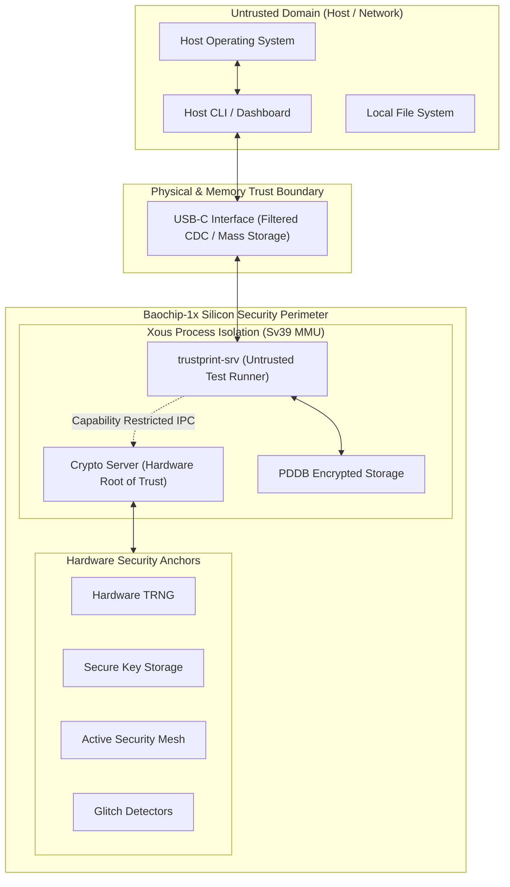

# 10 — Security Model & Threat Analysis

**Document Reference:** SEC-MODEL-001  
**Project:** TRUSTPRINT  
**Version:** 0.1.0-alpha  

---

## 1. Trust Boundaries & Threat Model

TRUSTPRINT is designed to audit silicon while simultaneously defending its own evidence from tampering, replay attacks, and side-channel leakage.



---

## 2. Threat Analysis & Mitigations

| Threat ID | Threat Description | Attack Vector | Severity | TRUSTPRINT Mitigation |
| :--- | :--- | :--- | :--- | :--- |
| **THREAT-01** | **Evidence Fabrication / Tampering** | Attacker edits JSON report values (e.g. changing FAIL to PASS). | HIGH | Canonical JSON hashing (SHA-512) and Ed25519 hardware signing. Any modified byte breaks the signature. |
| **THREAT-02** | **Test Runner Compromise** | Malicious or buggy test vector attempts to extract private signing keys. | HIGH | Sv39 virtual memory isolation. `trustprint-srv` runs in userland without physical mapping to crypto registers. |
| **THREAT-03** | **Replay Attack** | Attacker re-submits a valid old certificate for a different test run. | MEDIUM | Every evidence package includes a cryptographic nonce, ISO timestamp, and unique hardware DNA hash. |
| **THREAT-04** | **Hardware Glitch Attack** | Voltage or clock glitching during signature generation to induce fault. | HIGH | On-chip hardware glitch detectors automatically abort crypto operations if voltage/clock anomalies are detected. |
| **THREAT-05** | **Physical Probing of Silicon** | Physical microprobing of internal buses to intercept keys. | HIGH | Active top-metal security mesh detects physical cuts and automatically zeroes secure key storage. |
| **THREAT-06** | **Accidental Factory State Erasure** | Flashing image permanently transitions board to developer mode. | CRITICAL | Flashing protocol strictly uses standard userland UF2 files; no OTP fuse write commands exist in TRUSTPRINT codebase. |

---

## 3. Cryptographic Key Management

1. **Root Signing Key:** Generated on-chip using the Baochip-1x True Random Number Generator (TRNG) upon initial initialization.
2. **Private Key Storage:** Kept exclusively within the hardware security enclave or Xous encrypted PDDB basis; never exposed to userland memory or serial logs.
3. **Public Key Export:** Public key (`32-byte Ed25519`) is embedded directly in every generated `.tpe` certificate for independent verification.
4. **Development Fallback Mode:** When running on host simulators without hardware, software keys are used, and the certificate is explicitly stamped:
   ```json
   "signer_method": "SOFTWARE_DEVELOPMENT_KEY_UNAUTHENTICATED"
   ```

