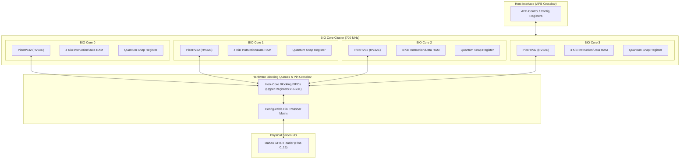

# 11 — BIO Coprocessor Engine Specification

**Document Reference:** SPEC-BIO-001  
**Project:** TRUSTPRINT  
**Version:** 0.1.0-alpha  

---

## 1. Architectural Overview

The **BIO (Bao I/O) Coprocessor** is a high-performance programmable I/O subsystem designed by Andrew "bunnie" Huang for the Baochip-1x SoC.

Unlike traditional microcontrollers that rely on rigid fixed-function peripherals (SPI, I2C, UART) or state-machine micro-code (such as the RP2040 PIO), the BIO subsystem integrates **four full 32-bit RISC-V CPU cores (PicoRV32)** running at **700 MHz**—twice the clock frequency of the main 350 MHz VexRiscv processor.



---

## 2. Key Novelties of the BIO Architecture

### 1. The RV32E Core Foundation
- Each BIO core is a **PicoRV32** implementing the **RV32E** instruction set (16 general-purpose registers `x0` through `x15`) with compressed instruction extensions (`C`) and hardware multiply/divide (`M`).
- Each core has **4 KiB of tightly-coupled private static RAM** holding both instructions and data, guaranteeing zero bus contention from the main CPU during high-speed execution.

### 2. Blocking FIFO Registers (`x16`–`x31`)
- Standard RISC-V instructions reference registers `x0`–`x31`. In the BIO RV32E implementation, registers `x16` through `x31` are wired directly to hardware queues and peripheral ports.
- **Blocking Read Semantics:** Executing an instruction like `mv t0, x16` halts the core in hardware if FIFO 0 is empty. As soon as a byte arrives, the instruction completes.
- **Blocking Write Semantics:** Executing `mv x16, t0` halts the core if FIFO 0 is full.
- This eliminates the need for polling loops, spinlocks, and mutexes, enabling clean inter-core pipeline architectures.

### 3. The "Snap to Quantum" Mechanism
- In high-speed bit-banging, cycle-counting assembly loops are fragile: compiler updates, cache misses, or branch mispredictions introduce jitter.
- The BIO coprocessor solves this by introducing a **hardware quantum clock**:
  - Writing to the quantum snap register stalls the PicoRV32 core until the next periodic quantum boundary.
  - The core wakes up synchronously with the clock edge, ensuring sub-nanosecond jitter tolerance across repeated pulse generation runs.

---

## 3. TRUSTPRINT Probing Roles

| BIO Core | Assigned Role in TRUSTPRINT | Implementation Details |
| :--- | :--- | :--- |
| **Core 0** | **Deterministic Pattern Generator** | Uses the quantum snap timer to generate square waves, clock trains, and serial bit patterns on designated output pins at exact clock intervals. |
| **Core 1** | **High-Speed Logic State Sampler** | Samples designated input pins on every quantum boundary; streams transition timestamps into blocking FIFO queues. |
| **Core 2** | **Protocol State Machine Checker** | Ingests sampled bitstreams from FIFO, verifies protocol state transitions (e.g., UART start/stop bit alignment or SPI clock phasing), and flags protocol violations. |
| **Core 3** | **DMA & Telemetry Aggregator** | Buffers verified transition records and handles APB DMA transfers back to the main CPU shared memory domain. |

---

## 4. Example BIO Firmware (RV32E Freestanding C)

```c
// bio/src/probe_core0.c
#include "bio_regs.h"

void main(void) {
    // Configure Pin 0 as BIO Output
    BIO_PIN_CONFIG = (1 << 0);

    // Loop generating 1 MHz square wave (500 ns half-period = 350 ticks @ 700 MHz)
    while (1) {
        // Toggle Pin 0 HIGH
        BIO_GPIO_SET = (1 << 0);
        // Snap to next 350-tick quantum boundary
        BIO_QUANTUM_SNAP = 350;

        // Toggle Pin 0 LOW
        BIO_GPIO_CLR = (1 << 0);
        // Snap to next 350-tick quantum boundary
        BIO_QUANTUM_SNAP = 350;
    }
}
```

