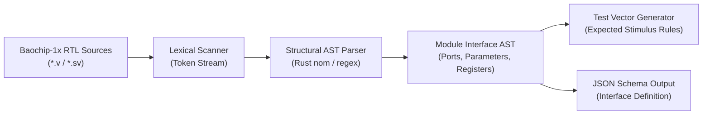

# 12 — RTL Intelligence & Analysis Engine

**Document Reference:** SPEC-RTL-001  
**Project:** TRUSTPRINT  
**Version:** 0.1.0-alpha  

---

## 1. Engine Purpose & Scope

The **RTL Intelligence Engine** (`trustprint-rtl`) bridges open-source hardware source code and physical test generation. It statically parses published Verilog-2001 and synthesizable SystemVerilog files from the official Baochip-1x repository to:
1. Extract module names, hierarchies, and parameter definitions.
2. Extract input, output, and bidirectional port declarations with bit-widths.
3. Extract memory-mapped register address maps and reset states.
4. Derive expected stimulus test configurations for the BIO coprocessor and simulation engine.

---

## 2. Parsing Architecture



### Supported Language Subset
To ensure high reliability without requiring commercial EDA synthesis tools, `trustprint-rtl` focuses on structural interface declarations:
- `module ... endmodule` definitions
- `parameter` and `localparam` values
- `input`, `output`, `inout` port lists (scalar and bit-vectored `[MSB:LSB]`)
- Register address offset defines (e.g., `\`define REG_CTRL 32'h00\``)
- Clock and reset signal identification

---

## 3. Extracted Interface Data Model

When parsing a module (e.g., `bio_bdma_wrapper.sv`), the engine generates a structured JSON representation:

```json
{
  "module_name": "bio_bdma_wrapper",
  "source_file": "dabao/rtl/bio_bdma_wrapper.sv",
  "parameters": [
    { "name": "NUM_CORES", "default_value": "4" },
    { "name": "RAM_SIZE_BYTES", "default_value": "4096" }
  ],
  "ports": [
    { "name": "clk", "direction": "input", "width": 1, "is_clock": true },
    { "name": "rst_n", "direction": "input", "width": 1, "is_reset": true },
    { "name": "apb_paddr", "direction": "input", "width": 32, "is_clock": false },
    { "name": "apb_pwdata", "direction": "input", "width": 32, "is_clock": false },
    { "name": "apb_prdata", "direction": "output", "width": 32, "is_clock": false },
    { "name": "gpio_out", "direction": "output", "width": 16, "is_clock": false },
    { "name": "gpio_in", "direction": "input", "width": 16, "is_clock": false }
  ],
  "register_map": [
    { "name": "BIO_CORE0_CTRL", "offset": "0x0000", "reset_val": "0x00000000" },
    { "name": "BIO_CORE0_STATUS", "offset": "0x0004", "reset_val": "0x00000001" },
    { "name": "BIO_QUANTUM_SNAP", "offset": "0x0010", "reset_val": "0x00000000" }
  ]
}
```

---

## 4. Automatic Test Vector Derivation

Based on the parsed port list:
1. All clock inputs (`is_clock: true`) generate periodic square-wave assertions in the simulation configuration.
2. All reset inputs (`is_reset: true`) generate active-low reset sequences (assert low for 10 cycles, deassert high).
3. Exposed GPIO output ports generate edge transition tracking listeners in the waveform evaluator.

