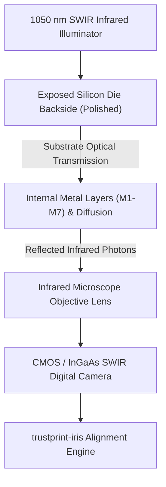
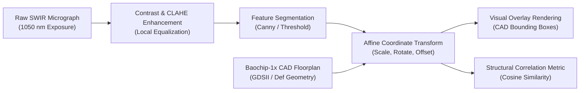

# 13 — IRIS Optical Die Inspection Engine

**Document Reference:** SPEC-IRIS-001  
**Project:** TRUSTPRINT  
**Version:** 0.2.0  

---

## 1. Physics & Scientific Principles of IRIS

**IRIS (Infra-Red In Situ)** is a non-destructive semiconductor inspection methodology pioneered by Andrew "bunnie" Huang.

Traditional failure analysis requires destructive chemical decapsulation (fuming nitric acid) to dissolve epoxy packaging, followed by polishing and scanning electron microscopy (SEM). This permanently destroys the chip and cannot be performed on running devices.

IRIS exploits a fundamental optical property of silicon:
- Silicon bandgap ≈ **1.12 eV** at room temperature.
- Visible light (< 1,000 nm) has photon energy exceeding this bandgap → silicon is opaque.
- **Short-Wave Infrared (SWIR)** at **1,000–1,600 nm (centred ~1,050 nm)** has photon energy *below* the bandgap → **silicon becomes optically transparent**.

Because the Baochip-1x is packaged in a form factor that exposes the backside of the silicon substrate (wafer-level chip scale package), shining infrared light through the backside illuminates internal metal layers, power grids, and memory arrays without physical destruction.



---

## 2. InspectionMode — Epistemic Provenance

The `inspect-die` subcommand and the `trustprint-iris` crate carry an explicit **`InspectionMode`** enum that is embedded in every inspection report:

| Mode | CLI flag | `is_synthetic` | `verification_status` |
|------|----------|----------------|----------------------|
| `DemonstrationSynthetic` | `--mode demo` (default) | `true` | `DEMONSTRATION_ONLY` |
| `PhysicalMicrograph` | `--mode physical --image <path>` | `false` | `VERIFIED_PHYSICAL` |

> [!IMPORTANT]
> Running `inspect-die` without `--image` **always** produces `DEMONSTRATION_ONLY` results.
> These are computed from a synthetic affine identity transform — no real micrograph is processed.
> Every output file, CLI line, and dashboard badge clearly states this.

### CLI Usage

```bash
# Demonstration mode (synthetic landmarks, no real image required):
cargo run -p trustprint-cli -- inspect-die --mode demo

# Physical mode (requires an actual SWIR micrograph JPEG/PNG):
cargo run -p trustprint-cli -- inspect-die --mode physical --image path/to/micrograph.png
```

---

## 3. LandmarkPair & Residuals

Each registration uses a set of `LandmarkPair` structs, one per fiducial:

```rust
pub struct LandmarkPair {
    pub label: String,
    pub optical_px: (f64, f64),   // pixel coordinate in micrograph
    pub cad_mm: (f64, f64),       // millimetre coordinate in CAD floorplan
    pub residual_px: Option<f64>, // |transformed_optical − cad| in pixels (None before solve)
    pub residual_distance_px: Option<f64>, // Euclidean residual distance (px)
}
```

After `compute_affine_transform()` and `compute_residuals()` are called, `residual_px` and `residual_distance_px` are populated. The CLI prints a landmark residual table:

```
Landmark            Optical (px)      CAD (mm)        Residual (px)
--------------------------------------------------------------------
die_corner_tl       (  50.0,  50.0)   (0.00, 0.00)       0.00
die_corner_tr       (1950.0,  50.0)   (2.00, 0.00)       0.00
...
RMS residual: 0.0000000000000142 px   [DEMONSTRATION_ONLY]
```

---

## 4. Image Processing & Floorplan Registration Pipeline



### Registration Algorithm Steps

1. **Histogram Equalization:** CLAHE enhances boundary definition between metal fill and transistor diffusion.
2. **Fiducial Alignment:** Identifies corner alignment markers and power ring perimeters.
3. **Affine Transformation Matrix:**

$$\begin{bmatrix} x_{cad} \\ y_{cad} \\ 1 \end{bmatrix} = \begin{bmatrix} a & b & t_x \\ c & d & t_y \\ 0 & 0 & 1 \end{bmatrix} \begin{bmatrix} x_{optical} \\ y_{optical} \\ 1 \end{bmatrix}$$

4. **Collinearity Pre-check:** `compute_affine_transform()` rejects degenerate landmark configurations where all points are collinear (singular matrix) — returns `IrisError::DegenerateLandmarks`.
5. **Residual Computation:** `compute_residuals()` populates `residual_px` on each `LandmarkPair`.
6. **Bounding Box Projection:** Renders CAD module regions (2 MiB SRAM, 4 MiB ReRAM, VexRiscv, BIO cluster, Crypto block) onto the optical image.

---

## 5. OpticalInspectionReport Fields

The JSON report at `artifacts/iris_inspection_report.json` contains:

| Field | Type | Description |
|-------|------|-------------|
| `inspection_mode` | String | `"DemonstrationSynthetic"` or `"PhysicalMicrograph"` |
| `is_synthetic` | bool | `true` if mode is Demonstration |
| `verification_status` | String | `"DEMONSTRATION_ONLY"` or `"VERIFIED_PHYSICAL"` |
| `transform` | Object | 6-element affine matrix `[a, b, c, d, tx, ty]` |
| `rms_error_px` | f64 | RMS landmark residual in pixels |
| `landmarks` | Array | Each `LandmarkPair` with residuals populated |
| `caveats` | Array<String> | Mode-appropriate epistemic caveats |
| `overlays` | Array | List of rendered CAD module overlays |

---

## 6. Error Handling

| Error Variant | Trigger | Recovery |
|---------------|---------|---------|
| `DegenerateLandmarks` | All landmarks collinear or fewer than 3 | Use at least 3 non-collinear fiducials |
| `ImageNotFound` | `--image` path does not exist | Provide a valid micrograph path |
| `SingularMatrix` | Affine matrix has zero determinant (legacy) | Use `DegenerateLandmarks` path |

---

## 7. Epistemic Limits of Optical Inspection

> [!IMPORTANT]
> **What IRIS Proves:** Macro-scale architectural functional blocks physically exist at declared coordinates with macroscopic geometric fidelity to published floorplans.
>
> **What IRIS Cannot Prove:** Individual standard-cell logic gates at 22 nm (optical diffraction limits resolution to ~0.5 µm). Single-transistor modifications or unrouted sub-micron logic alterations in lower metal layers.

| Verification Status | Landmark Source | Micrograph | RMS Significance |
|--------------------|-----------------|-----------|-----------------|
| `DEMONSTRATION_ONLY` | Synthetic grid | None | Meaningless (identity transform) |
| `VERIFIED_PHYSICAL` | Manually placed on real micrograph | Real SWIR image required | Geometric alignment quality |

For full limitations, see `docs/20-research-limitations.md`.
