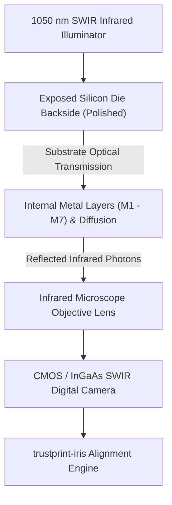
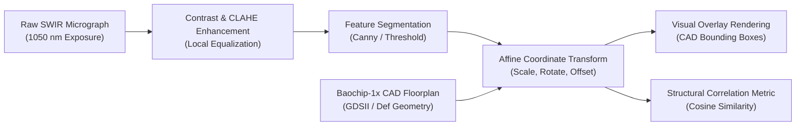

# 13 — IRIS Optical Die Inspection Engine

**Document Reference:** SPEC-IRIS-001  
**Project:** TRUSTPRINT  
**Version:** 0.1.0-alpha  

---

## 1. Physics & Scientific Principles of IRIS

**IRIS (Infra-Red In Situ)** is a non-destructive semiconductor inspection methodology pioneered by Andrew "bunnie" Huang.

Traditional failure analysis and silicon inspection requires destructive chemical decapsulation (fuming nitric acid) to dissolve the epoxy packaging, followed by polishing and scanning electron microscopy (SEM). This permanently destroys the chip and cannot be performed on active, running devices.

IRIS exploits a fundamental optical property of silicon:
- Silicon has a bandgap of approximately **1.12 eV** at room temperature.
- Visible light (wavelengths $< 1,000$ nm) has photon energy exceeding this bandgap and is absorbed by valence electrons, rendering silicon opaque to the human eye.
- **Short-Wave Infrared (SWIR) light** at wavelengths between **1,000 nm and 1,600 nm (specifically centered around 1,050 nm)** has photon energy *below* the bandgap ($E < 1.12$ eV).
- Consequently, **silicon becomes optically transparent to infrared light**.

Because the Baochip-1x is packaged in a form factor that exposes the backside of the silicon substrate (wafer-level chip scale package), shining infrared light through the backside illuminates the internal metal layers, power grids, and memory arrays without physical destruction.

---

## 2. Image Processing & Floorplan Registration Pipeline

### Registration Algorithm Steps
1. **Histogram Equalization:** Infrared micrographs often have low dynamic range; Contrast Limited Adaptive Histogram Equalization (CLAHE) enhances boundary definition between metal fill and transistor diffusion.
2. **Fiducial Alignment:** Identifies corner alignment markers and power ring perimeters on the physical die.
3. **Affine Transformation Matrix:** Solves the 2D affine mapping matrix:
   $$\begin{bmatrix} x_{cad} \\ y_{cad} \\ 1 \end{bmatrix} = \begin{bmatrix} a & b & t_x \\ c & d & t_y \\ 0 & 0 & 1 \end{bmatrix} \begin{bmatrix} x_{optical} \\ y_{optical} \\ 1 \end{bmatrix}$$
4. **Bounding Box Projection:** Renders CAD module regions (2 MiB SRAM array, 4 MiB ReRAM tile, VexRiscv core, BIO cluster) directly onto the optical image.

---

## 3. Epistemic Limits of Optical Inspection

> [!IMPORTANT]
> **What IRIS Proves:** It proves whether macro-scale architectural functional blocks physically exist at the declared coordinates and exhibit macroscopic geometric fidelity with published floorplans.
>
> **What IRIS Cannot Prove:** It cannot resolve individual standard-cell logic gates at the 22nm node (optical diffraction limits resolution to approximately $0.5\ \mu\text{m}$). It cannot detect single-transistor modifications or unrouted sub-micron logic alterations in lower metal layers.

