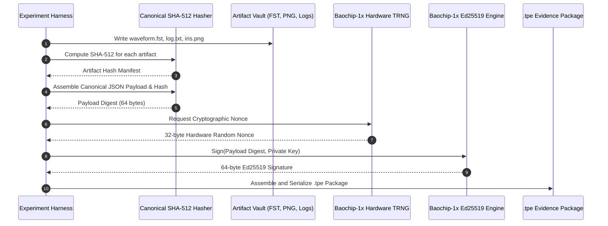

# 14 — Cryptographic Evidence & Attestation Engine

**Document Reference:** SPEC-CRYPTO-001  
**Project:** TRUSTPRINT  
**Version:** 0.1.0-alpha  

---

## 1. Objective: Tamper-Evident Research Provenance

In semiconductor verification, generating test results is insufficient unless the evidence is **cryptographically bound to the physical device that executed it**.

TRUSTPRINT implements a complete hardware-anchored attestation engine (`trustprint-evidence`) that guarantees:
1. **Integrity:** Test parameters, waveforms, logs, and optical images cannot be modified after execution without invalidating the cryptographic signature.
2. **Authenticity:** Every report is signed by an Ed25519 private key generated via the Baochip-1x hardware True Random Number Generator (TRNG).
3. **Non-Repudiation & Provenance:** The certificate includes unique silicon identifiers (Silicon DNA hash, manufacturing batch metadata, firmware build hash).

---

## 2. Attestation Generation Pipeline



---

## 3. Canonical Serialization & Hashing Standard

Cryptographic signature verification on JSON payloads frequently fails across heterogeneous platforms due to whitespace differences, key ordering, or floating-point representation variances.

TRUSTPRINT enforces **RFC 8785 (JSON Canonicalization Scheme - JCS)**:
1. **Key Ordering:** All dictionary keys are sorted in lexicographical ASCII order.
2. **Whitespace:** Zero extra whitespace or newlines between tokens (`:` and `,`).
3. **Number Representation:** Integers are encoded without leading zeros; floats follow strict IEEE 754 canonical string formatting.
4. **Encoding:** Strict UTF-8 without byte-order marks (BOM).

---

## 4. Independent Host-Side Verification Protocol

An external auditor can verify a `.tpe` evidence package using the standalone CLI without requiring the physical Dabao board:

```bash
# Verify certificate signature and artifact integrity
cargo run -p trustprint-cli -- verify-evidence --evidence evidence/EXP-001.tpe
```

### Verification Steps Executed:
1. Extract `cryptographic_attestation.signer_public_key_hex` and `signature_hex`.
2. Reconstruct the canonical JSON string of the evidence package excluding the `signature_hex` field.
3. Compute `SHA-512` over the canonical string.
4. Verify the `Ed25519` signature against the extracted public key and computed digest.
5. Ingest each external artifact file referenced in `artifacts[]` and recompute its `SHA-512` hash.
6. Verify that 100% of artifact hashes match the declared hashes in the manifest.
7. Emit conclusive verdict: `VERDICT: VALID_AUTHENTICATED_EVIDENCE`.

