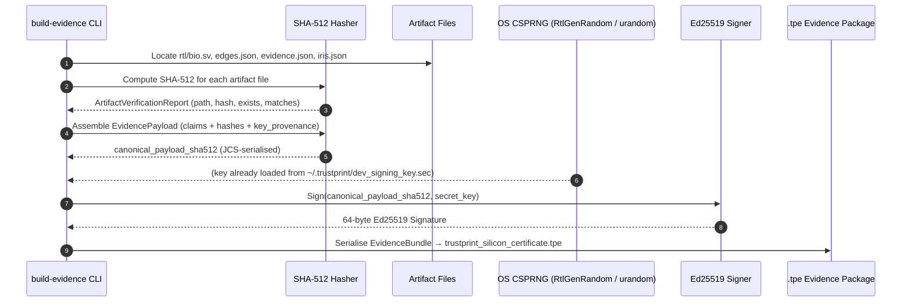

# 14 — Cryptographic Evidence & Attestation Engine

**Document Reference:** SPEC-CRYPTO-001  
**Project:** TRUSTPRINT  
**Version:** 0.2.0  

---

## 1. Objective: Tamper-Evident Research Provenance

In semiconductor verification, generating test results is insufficient unless the evidence is **cryptographically bound to the artifacts that produced it**.

TRUSTPRINT implements a complete attestation engine (`trustprint-evidence`) that guarantees:
1. **Integrity:** Test parameters, waveforms, logs, and optical images cannot be modified after signing without invalidating the cryptographic signature.
2. **Authenticity:** Every report is signed by an Ed25519 private key generated from the OS CSPRNG (`RtlGenRandom` on Windows, `/dev/urandom` on Linux/macOS).
3. **Non-Repudiation & Provenance:** The certificate includes unique silicon identifiers (serial number, wafer lot, UUID, boot hash), artifact hashes, and an explicit `KeyProvenance` field declaring the origin of the signing key.

> [!IMPORTANT]
> The signing key is currently a **host-generated development key** (`KeyProvenance::DevelopmentHostKey`).
> It is stored at `~/.trustprint/dev_signing_key.sec` and auto-generated on first use.
> This is **not** a hardware-rooted key. The `.tpe` package proves evidence integrity and authorship of the
> signing key holder; it does not prove the data originated from genuine physical hardware.

---

## 2. Key Management

### Key Generation

```bash
# Key is auto-generated on first `build-evidence` call:
cargo run -p trustprint-cli -- build-evidence
# Key stored at: ~/.trustprint/dev_signing_key.sec  (32 raw Ed25519 secret bytes)
```

The generation flow uses `generate_random_keypair()` in `crates/trustprint-evidence/src/signer.rs`:

1. Calls `os_random_bytes()` — Windows: `RtlGenRandom` (advapi32); others: `/dev/urandom`.
2. Derives Ed25519 keypair from the 32-byte random seed.
3. Saves the secret bytes to `~/.trustprint/dev_signing_key.sec` (file must have mode 0o600 on Unix).

### Key Persistence

If `dev_signing_key.sec` already exists, `load_or_generate_key()` loads it and reuses it. This ensures `.tpe` bundles remain verifiable across runs with the same key.

> [!CAUTION]
> Do **not** commit `dev_signing_key.sec` to git. The `.gitignore` excludes `.trustprint/`.
> If the key is lost, existing `.tpe` bundles can still be signature-verified with the
> public key recorded inside the bundle, but new bundles will bear a different public key.

### KeyProvenance Field

Every `EvidencePayload` carries a `key_provenance` field (enum serialized as a string):

| Variant | Meaning |
|---------|---------|
| `DevelopmentHostKey` | Key generated by OS CSPRNG on the development workstation |
| `HardwareTrng` | Key generated by physical Baochip-1x TRNG (future / on-board use) |

---

## 3. Attestation Generation Pipeline



---

## 4. EvidenceBundle Schema

```json
{
  "payload": {
    "bundle_id": "TPE-xxxxxxxx",
    "created_at_utc": "2026-11-12T...",
    "canonical_payload_sha512": "...",
    "claims": [ ... ],
    "key_provenance": "DevelopmentHostKey",
    "artifact_hashes": {
      "rtl/bio.sv":                                    "sha512:...",
      "artifacts/trustprint_multicore_edges.json":     "sha512:...",
      "artifacts/dabao_physical_evidence.json":        "sha512:...",
      "artifacts/iris_inspection_report.json":         "sha512:..."
    }
  },
  "attestation_signature": "hex...",
  "signer_public_key_hex": "hex..."
}
```

### TierClaim Fields

Each claim inside `claims[]` has:

| Field | Type | Description |
|-------|------|-------------|
| `tier` | u8 | Epistemic tier (1–5) |
| `label` | String | Human-readable claim label |
| `verdict` | String | `PASS`, `FAIL`, `INCONCLUSIVE`, `NOT_RUN`, `BLOCKED`, `SIMULATED`, `DEMONSTRATION_ONLY` |
| `evidence_hash` | String | SHA-512 of the evidence data |
| `artifact_rel_path` | Option<String> | Relative path to the artifact file on disk |

### ArtifactVerificationReport

Returned by `verify_bundle_artifacts()`:

| Field | Type | Description |
|-------|------|-------------|
| `path` | String | Relative artifact path |
| `expected_hash` | String | Hash recorded in the bundle |
| `actual_hash` | Option<String> | Recomputed hash of on-disk file |
| `file_exists` | bool | Whether file was found |
| `hash_matches` | bool | Whether hashes match |

---

## 5. Canonical Serialization & Hashing Standard

TRUSTPRINT enforces **RFC 8785 (JSON Canonicalization Scheme - JCS)**:
1. **Key Ordering:** All dictionary keys sorted in lexicographical ASCII order.
2. **Whitespace:** Zero extra whitespace or newlines.
3. **Number Representation:** Integers without leading zeros; floats per IEEE 754 canonical string.
4. **Encoding:** Strict UTF-8, no BOM.

---

## 6. Independent Host-Side Verification Protocol

An external auditor can verify a `.tpe` evidence package without the physical Dabao board:

```bash
# Basic verification (signature + artifact hashes):
cargo run -p trustprint-cli -- verify-evidence artifacts/trustprint_silicon_certificate.tpe

# With trust anchor (reject keys that don't match):
cargo run -p trustprint-cli -- verify-evidence artifacts/trustprint_silicon_certificate.tpe \
    --trusted-key a81b17441380b2c38d314259d6f15d92ad72c054db82c510f34b0172f49b3c91
```

### Verification Steps Executed

1. Deserialise the `.tpe` JSON file into `EvidenceBundle`.
2. Extract `signer_public_key_hex` and `attestation_signature`.
3. Reconstruct the canonical JSON string of `payload` (JCS serialisation).
4. Compute SHA-512 over the canonical bytes.
5. Verify the Ed25519 signature against the reconstructed digest and public key.
6. If `--trusted-key` is provided, compare it against `signer_public_key_hex`; fail with `UntrustedSigner` if they differ.
7. Call `verify_bundle_artifacts()`: for each artifact listed in `artifact_hashes`, re-read the on-disk file, compute SHA-512, compare to the bundle.
8. Emit conclusive verdict per artifact and overall `VERDICT: VALID_AUTHENTICATED_EVIDENCE`.

### Exit Codes

| Scenario | Exit Code |
|----------|-----------|
| All checks pass | 0 |
| Signature invalid | 1 |
| `--trusted-key` mismatch | 1 |
| Any artifact hash mismatch | 1 |
| File parse or I/O error | 1 |

---

## 7. Epistemic Boundaries

| What Ed25519 attestation proves | What it does NOT prove |
|---------------------------------|-----------------------|
| The bundle was not tampered with after signing | The data originated from genuine physical hardware |
| The bundle was signed by the holder of `dev_signing_key.sec` | The signing key was generated on the physical Dabao |
| All referenced artifact files have not changed since signing | The measurements reflect physical silicon behaviour |

These limits are stated in the CLI output and in `docs/20-research-limitations.md`.
