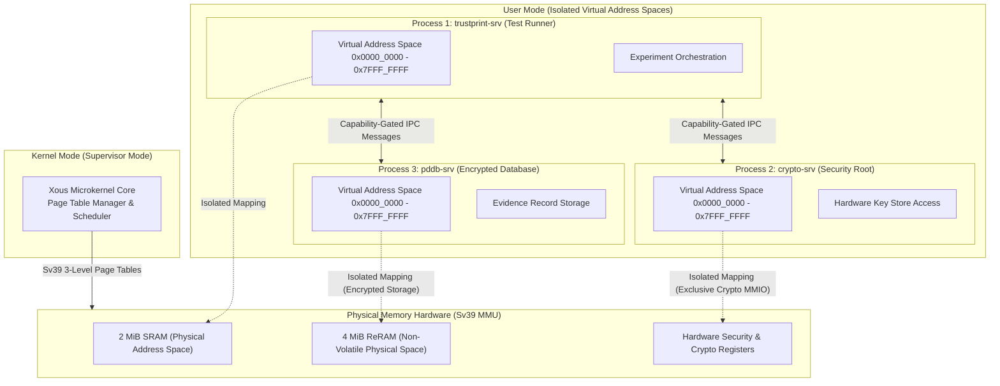

# 15 — Xous Microkernel & MMU Process Isolation

**Document Reference:** SPEC-MMU-001  
**Project:** TRUSTPRINT  
**Version:** 0.1.0-alpha  

---

## 1. High-Assurance Embedded Architecture

Most commercial microcontrollers operate with flat, unprotected physical memory address spaces or rudimentary Memory Protection Units (MPUs) limited to 8 or 16 fixed regions. Under these legacy architectures, any buffer overflow or errant pointer in experimental code can overwrite root-of-trust secrets, bootloader code, or peripheral control registers.

The **Baochip-1x** breaks this mold by incorporating a full **RISC-V Sv39 Virtual Memory Management Unit (MMU)** alongside its 350 MHz VexRiscv core.

This hardware foundation enables **Xous**, a pure-Rust, capability-based microkernel operating system developed by the Betrusted team.

---

## 2. Sv39 Virtual Memory Organization in Xous

In RISC-V Sv39:
- Virtual addresses are **39 bits** wide, providing a 512 GiB virtual address space per process.
- Physical addresses are **56 bits** wide.
- Page size is **4 KiB**, managed through a three-level hierarchical page table tree.
- Each userland process in Xous occupies an independent root page table (`satp` register swapped on context switch).

### Memory Separation Guarantees
1. **Zero Direct Access to Cryptographic Keys:** The `trustprint-srv` process has zero page mappings to the physical address space of the hardware security subsystem.
2. **Capability-Gated IPC:** To request a signature or query the TRNG, `trustprint-srv` must dispatch an asynchronous IPC message across the microkernel boundary to `crypto-srv`.
3. **Hardware Trap on Illegal Memory Access:** Any direct pointer dereference outside a process's allocated virtual pages triggers an immediate RISC-V hardware `PageFault` exception (`mcause = 13` or `15`).

---

## 3. Deliberate Isolation Validation Test (`TEST-MMU-001`)

To demonstrate the reality of MMU process isolation to hackathon judges, TRUSTPRINT includes a deliberate test vector:
1. `trustprint-srv` attempts to directly read physical memory at `0x4010_0000` (crypto key storage).
2. The RISC-V MMU halts the execution instruction and triggers an unhandled page fault exception.
3. The Xous microkernel safely terminates the faulting thread, emits an isolated error report via UART, and keeps the operating system and crypto services running.
4. This confirms to evaluators that open-silicon memory protection operates with true hardware enforcement.

