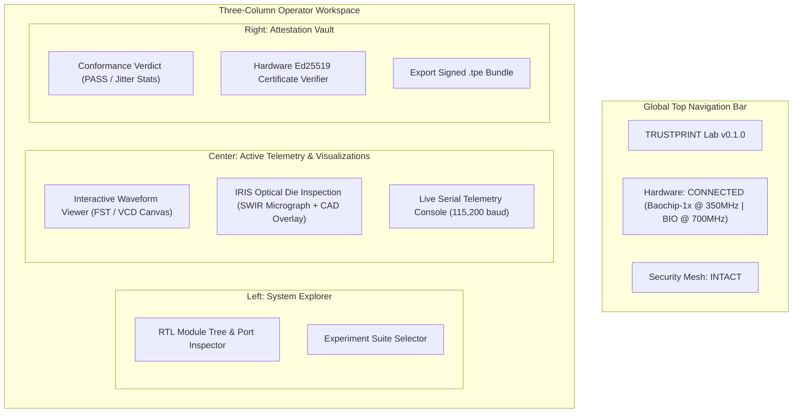

# 17 — UI/UX Specification: Operator Research Dashboard

**Document Reference:** SPEC-UIUX-001  
**Project:** TRUSTPRINT  
**Version:** 0.1.0-alpha  

---

## 1. UI Design Principles

The TRUSTPRINT Operator Dashboard is an engineering research tool built for researchers, auditors, and hackathon evaluators.

- **Dark Mode Silicon Aesthetic:** Clean, high-contrast dark theme (#0d1117 background, #58a6ff accents, #3fb950 pass green, #f85149 fail red).
- **Zero Mock Concealment:** If data is simulated, an amber banner displays: `[SIMULATION / MOCK RUNTIME — NOT PHYSICAL SILICON]`.
- **High-Density Data Visualization:** Waveforms and register states render on high-performance HTML5 Canvas / WebGL.

---

## 2. Dashboard Screen Wireframes & Component Layout

---

## 3. Screen Specifications

### Screen 1: Overview & Hardware Status
- Displays live CPU frequency (350 MHz), BIO frequency (700 MHz), voltage rail health, active security mesh state, and glitch counter.
- Shows connection status indicator (USB CDC serial or Simulator backend).

### Screen 2: RTL Explorer
- Interactive tree view of parsed Verilog modules (`bio_bdma_wrapper`, `uart`, `pke_engine`).
- Clicking a module renders its port list, clock parameters, and register offset table.

### Screen 3: Waveform Viewer (Digital Trace Canvas)
- Renders high-speed digital logic traces (`gpio_out[0]`, `gpio_in[1]`, `quantum_snap_tick`).
- Features interactive pan and zoom down to picosecond resolution.
- Renders expected timing envelope boundary lines in dashed green.

### Screen 4: IRIS Die Inspection Viewer
- Split-screen comparison or translucent overlay slider comparing SWIR 1050nm infrared optical micrographs against CAD floorplan bounding boxes.
- Interactive toggle buttons highlighting SRAM arrays, ReRAM matrices, and CPU core perimeters.

### Screen 5: Evidence & Certificate Verifier
- Drag-and-drop zone for `.tpe` evidence bundles.
- Displays full cryptographic hash tree, Ed25519 signature validity status, and hardware provenance metadata.

