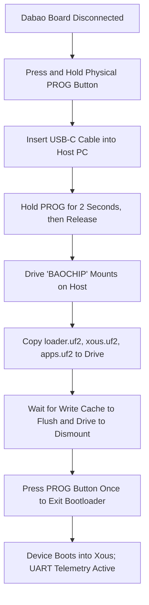

# 18 — Deployment & Build Guide

**Document Reference:** BUILD-DEP-001  
**Project:** TRUSTPRINT  
**Version:** 0.1.0-alpha  

---

## 1. Host System Setup & Prerequisites

### A. Linux (Ubuntu 22.04 LTS / Debian 12)
```bash
# Update system and install essential build packages
sudo apt update && sudo apt install -y \
    build-essential git curl cmake pkg-config libssl-dev \
    verilator gtkwave python3 python3-pip python3-venv

# Install Rust toolchain
curl --proto '=https' --tlsv1.2 -sSf https://sh.rustup.rs | sh
source $HOME/.cargo/env
rustup target add riscv32imac-unknown-none-elf

# Install Zig compiler (0.12+)
sudo snap install zig --classic --beta
```

### B. Windows 11 (PowerShell 7 / WSL2)
```powershell
# Using winget / scoop
winget install Rustlang.Rustup
rustup target add riscv32imac-unknown-none-elf
winget install zig.zig
winget install Python.Python.3.11
```

---

## 2. Building the Simulation Harness (`bio-sim`)

```bash
# Clone the official BIO simulator
git clone https://github.com/baochip/bio-sim.git
cd bio-sim

# Compile the Verilated C++ model
make -j$(nproc) build

# Execute sanity self-test
./simulate configs/smoke.jsonc
```

---

## 3. Building the Xous Dabao Firmware

```bash
# Clone Xous-core with all tags
git clone https://github.com/betrusted-io/xous-core.git
cd xous-core
git fetch --tags

# Build Dabao console and TRUSTPRINT services
cargo xtask dabao dabao-console
```

The compiled UF2 binaries will be located at:
- `target/riscv32imac-unknown-xous-elf/release/loader.uf2`
- `target/riscv32imac-unknown-xous-elf/release/xous.uf2`
- `target/riscv32imac-unknown-xous-elf/release/apps.uf2`

---

## 4. Hardware Flashing Procedure (Safety Verified)



