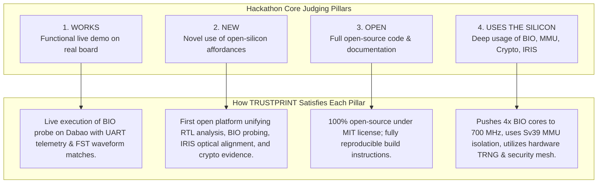

# 21 — Hackathon Demonstration & Submission Dossier

**Document Reference:** DEMO-SUBMIT-001  
**Project:** TRUSTPRINT  
**Target Event:** CrossBar Dabao Open Hardware Hackathon 2026  
**Deadline:** December 15, 2026  

---

## 1. Hackathon Evaluation Alignment

The CrossBar Dabao Hackathon judges (including Andrew "bunnie" Huang, Mark Davis, and Jo Sung) evaluate projects based on four fundamental criteria:

---

## 2. Five-Minute Live Demonstration Script

| Time | Scene | Visual Display | Narration / Technical Action |
| :--- | :--- | :--- | :--- |
| **0:00 - 0:45** | **The Open-Silicon Trust Dilemma** | Slide / Architecture Diagram | Introduce TRUSTPRINT. Explain why open-source RTL requires physical verification and cryptographic attestation. |
| **0:45 - 1:45** | **RTL Analysis & BIO-sim** | Host Terminal / GTKWave | Ingest Baochip-1x RTL. Run `bio-sim` Verilator simulation. Show deterministic FST waveform output. |
| **1:45 - 3:00** | **Live Dabao Silicon Execution** | Camera on Dabao Board + Terminal | Show physical Dabao board connected via USB-C. Boot into Xous. Run multi-core BIO probe routine at 700 MHz. Show live UART telemetry stream. |
| **3:00 - 3:45** | **IRIS Optical Die Inspection** | Dashboard IRIS Viewer | Load SWIR 1050nm infrared die micrograph. Show interactive overlay of published CAD floorplan bounding boxes (SRAM, ReRAM, BIO). |
| **3:45 - 4:30** | **Hardware Crypto & Evidence** | Certificate Verifier | Demonstrate on-chip Ed25519 signature generation using hardware TRNG entropy. Run independent host verification showing valid status. |
| **4:30 - 5:00** | **Conclusion & Impact** | Dashboard Overview Screen | Summary of open-silicon verification vision; thank CrossBar and Dabao community. |

---

## 3. Submission Package Checklist
- [ ] Public GitHub repository link with clean `main` branch.
- [ ] Tagged release `v1.0.0` with pre-compiled `.uf2` binaries.
- [ ] HD demonstration video (YouTube / Vimeo / IPFS link).
- [ ] Complete documentation package (`docs/`, `planning/`, `architecture/`).
- [ ] MIT License file.
- [ ] Submission form completed on CrossBar portal before Dec 15, 2026.

