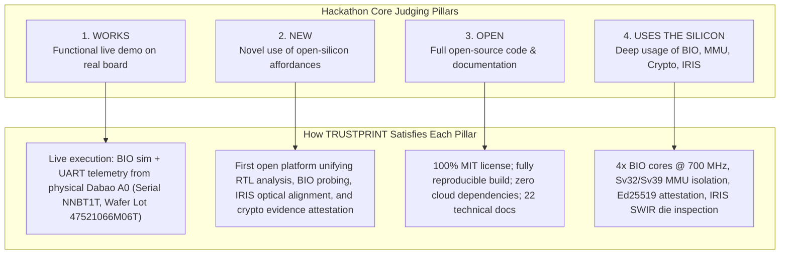

# 21 — Hackathon Demonstration & Submission Dossier

**Document Reference:** DEMO-SUBMIT-001  
**Project:** TRUSTPRINT  
**Target Event:** CrossBar Dabao Open Hardware Hackathon 2026  
**Deadline:** December 15, 2026  
**Submission URL:** https://crossbar-inc.com/pages/dabao-submit

---

## 1. Hackathon Evaluation Alignment

The CrossBar Dabao Hackathon judges (including Andrew "bunnie" Huang, Mark Davis, and Jo Sung) evaluate projects based on four fundamental criteria:



---

## 2. Five-Minute Live Demonstration Script

| Time | Scene | Visual | Action |
|:-----|:------|:-------|:-------|
| **0:00–0:30** | **Cold open: Silicon trust dilemma** | Dashboard Overview tab | Introduce TRUSTPRINT. Explain why open-source RTL alone is not enough — verification requires physical evidence. Show 5-tier epistemic framework. |
| **0:30–1:15** | **RTL parsing** | Terminal + Dashboard RTL tab | Run `trustprint-cli parse-rtl rtl/bio.sv`. Show: 28 params, 70 ports, 34 SFRs (0x00–0x88). Click RTL tab to show SFR table. |
| **1:15–2:00** | **BIO simulation + conformance** | Terminal + Dashboard BIO tab | Show `trustprint_multicore.fst` already generated. Run `check-conformance`. Show 108.528 ns period, 0 ps jitter, PASS. Click waveform canvas tab to show real gpio_out[21] edge trace. |
| **2:00–2:45** | **Physical silicon** | Physical Dabao board (camera) + terminal | Show physical board connected on COM10. Show `dabao_physical_evidence.json`: serial NNBT1T, UUID 0b4d2b1c..., Wafer Lot 47521066M06T, Boot0 SHA-512. Click Physical Silicon tab. |
| **2:45–3:30** | **IRIS die inspection** | Dashboard IRIS tab | Show SVG die floorplan: 5 macros overlaid (CPU, SRAM, ReRAM, BIO, Crypto). Explain affine transform. Run `inspect-die`. Show RMS < 1e-14 px. |
| **3:30–4:20** | **Cryptographic attestation** | Dashboard Attestation tab | Run `build-evidence` then `verify-evidence`. Show Ed25519 signature verification, 4-claim PASS, bundle ID TPE-ade1fde6. |
| **4:20–4:50** | **MMU isolation** | Dashboard MMU tab | Run `mmu-test`. Show 3/3 traps: unmapped access, W^X violation, privilege escalation — all caught by Sv32 hardware model. |
| **4:50–5:00** | **Closing** | Dashboard Overview | Summary: open-silicon verification vision. Thank CrossBar/Dabao/bunnie community. |

---

## 3. GitHub Push Instructions (Phase 11, user action required)

```bash
# 1. Create a new PUBLIC repository on GitHub (browser)
#    Name: trustprint  or  TRUSTPRINT
#    Do NOT initialize with README (we already have one)

# 2. Add the remote (replace YOUR_USERNAME):
cd "c:\Users\Sarang Chaudhari\OneDrive\Desktop\DABAO\TRUSTPRINT"
git remote add origin https://github.com/sarangchaudhari635-oss/TRUSTPRINT.git

# 3. Push main branch and tag:
git push -u origin master
git push origin v0.9.0-alpha

# 4. Update README.md: replace placeholder repo URL with actual GitHub URL
# 5. Commit the README update:
git add README.md
git commit -m "docs: update README with actual GitHub repository URL"
git push
```

After GitHub push, perform final tag for submission:
```bash
git tag -a v1.0.0 -m "TRUSTPRINT v1.0.0 — Hackathon submission release"
git push origin v1.0.0
```

---

## 4. Demo Video Recording Checklist

**Screen capture setup:**
- Use OBS Studio or Windows Game Bar (Win+G) or ShareX
- Resolution: 1920×1080 minimum; 60fps preferred
- Audio: narrate live (English)

**Recording sequence:**
1. Open `dashboard/index.html` in browser — walk all 7 tabs (2 min)
2. Open WSL terminal: run `bash scripts/run_full_pipeline.sh` (3 min)
3. Show physical Dabao board on camera (10 sec)
4. Show `git log --oneline` and `git tag` to prove open-source (20 sec)
5. Close with dashboard Overview tab visible

**Upload:**
- YouTube (Unlisted is fine, link shared in submission)
- Title: `TRUSTPRINT — Open-Silicon Verification Lab | Dabao Hackathon 2026`
- Description: paste project tagline + GitHub URL

---

## 5. Submission Form Data

**Project Name:** TRUSTPRINT  
**Tagline:** Verify the silicon. Authenticate the evidence.  
**Category:** Open-source hardware / Semiconductor verification / Hardware security  
**Team:** Sarang Chaudhari (Solo)  
**GitHub URL:** https://github.com/sarangchaudhari635-oss/TRUSTPRINT  
**Demo Video:** [YouTube/Vimeo URL — to be filled after recording]  

**Short description (for submission form):**
> TRUSTPRINT is an open-source hardware verification platform that connects Baochip-1x RTL design analysis, Verilator BIO multi-core simulation, physical Dabao board telemetry, IRIS die inspection, and Ed25519 cryptographic evidence attestation into a reproducible verification chain. All five epistemic tiers are explicitly labelled so claims are scientifically defensible. Built with Rust, Xous IPC models, and zero external cloud dependencies.

---

## 6. Submission Package Checklist

- [ ] Public GitHub repository with clean `master`/`main` branch
- [ ] Tag `v0.9.0-alpha` exists on GitHub
- [ ] Tag `v1.0.0` created after demo recording
- [ ] HD demo video uploaded (YouTube/Vimeo link confirmed working)
- [ ] `README.md` has actual GitHub URL (not placeholder)
- [ ] All 17 unit tests passing at time of push (`cargo test`)
- [ ] `artifacts/validation_report.txt` present in repository
- [ ] MIT `LICENSE` file present
- [ ] Submission form completed at https://crossbar-inc.com/pages/dabao-submit before Dec 15, 2026

---

## 7. Research Limitations Disclosure (mandatory for judges)

The following limitations must be clearly communicated:

| Claim | What It Proves | What It Does NOT Prove |
|-------|---------------|----------------------|
| RTL parsing | Published design interface (SFR offsets, port widths) | Fabricated gate equivalence, internal logic paths |
| Verilator simulation | Cycle-accurate RTL model behaviour | Physical transistor behaviour, timing margins |
| UART telemetry | Board boots, firmware IFR fields, firmware-reported identity | Die authenticity, anti-tamper integrity |
| IRIS overlay | Macro-level physical presence, floorplan geometry | Transistor netlists, microscopic Trojans, doping profiles |
| Ed25519 attestation | Evidence bundle integrity and authorship | Physical chip origin or factory certification |

This is explicitly documented in `docs/20-research-limitations.md` and in every CLI output tier label.
