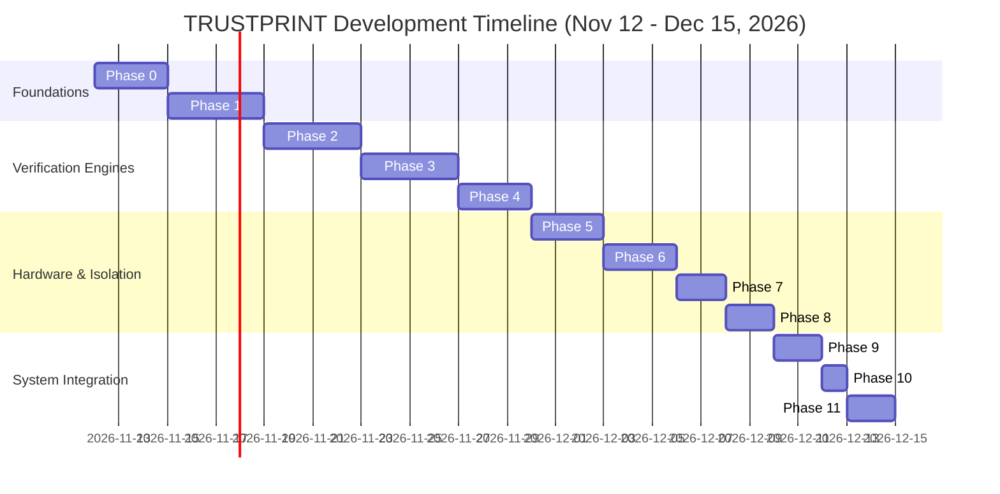

# TRUSTPRINT Master Roadmap

## 1. Hackathon Timeline & Operational Context
- **Target Event:** CrossBar Dabao Open Hardware Hackathon 2026
- **Submission Deadline:** December 15, 2026 (Final results announced December 18, 2026)
- **Available Timeframe:** ~33 days (~4.5 weeks)
- **Execution Model:** Solo Developer & Hardware Researcher

---

## 2. Phase-by-Phase Roadmap

---

## 3. Phase Specifications

### Phase 0: Research, Feasibility & Formal Documentation (Nov 12 – Nov 15)
- **Objective:** Establish epistemic boundaries, review Baochip-1x architecture, verify toolchain feasibility, and construct comprehensive documentation architecture.
- **Key Deliverables:** PRD, Architecture Specs, Tech Stack Matrix, Error Knowledge Base, Research Reviews.
- **Exit Gate:** Complete documentation package reviewed and validated.

### Phase 1: Toolchain Setup & BIO-sim Simulation Harness (Nov 15 – Nov 19)
- **Objective:** Establish reproducible host build environments for Rust, RISC-V targets, Zig/clang, and Verilator. Run initial `bio-sim` smoke tests and verify waveform generation.
- **Key Deliverables:** Host build scripts, automated `bio-sim` runner, baseline `.fst` waveform parsing pipeline.
- **Exit Gate:** `make build` and `./simulate configs/hello-world.jsonc` pass deterministically on host.

### Phase 2: RTL Analysis & Test-Generation Engine (Nov 19 – Nov 23)
- **Objective:** Build the static structural Verilog parser in Rust/Python to ingest open-source Baochip-1x RTL. Extract module definitions, port lists, register interfaces, and state-machine transitions.
- **Key Deliverables:** `trustprint-rtl` crate, automated pin-mapping extractor, test-vector generator.
- **Exit Gate:** Automatic generation of stimulus test cases from Verilog module headers.

### Phase 3: BIO Experiment Execution Engine (Nov 23 – Nov 27)
- **Objective:** Develop high-precision BIO C and assembly programs targeting the 4x 700 MHz PicoRV32 cores. Implement blocking FIFO queues, snap-to-quantum timing, and deterministic GPIO pulse trains.
- **Key Deliverables:** BIO test vector firmware (`sw/bio_probe.c`), multi-core synchronization primitives.
- **Exit Gate:** Multi-core BIO firmware running inside `bio-sim` without deadlocks or FIFO overflows.

### Phase 4: Waveform Capture & Conformance Engine (Nov 27 – Nov 30)
- **Objective:** Implement the waveform transition parser. Ingest `.fst` simulation traces and compare observed transitions against expected timing envelopes extracted in Phase 2.
- **Key Deliverables:** `trustprint-waveform` engine, automated jitter and propagation delay comparator.
- **Exit Gate:** Automated PASS/FAIL evaluation of simulated waveform traces against mathematical tolerances.

### Phase 5: Physical Dabao Hardware Integration (Nov 30 – Dec 03)
- **Objective:** Transition from simulation to physical silicon. Establish USB-C communication, flash verified BIO routines to the Dabao board, and record real GPIO activity.
- **Key Deliverables:** Physical board runner, UART telemetry streamer, GPIO test probe harness.
- **Exit Gate:** Successful execution of BIO stimulus on physical Baochip-1x silicon with verified UART reporting.

### Phase 6: IRIS Die Inspection & Structural Registration (Dec 03 – Dec 06)
- **Objective:** Incorporate physical optical die verification. Ingest SWIR infrared die imagery, segment macroscopic silicon features (SRAM, ReRAM, security mesh), and register against design floorplans.
- **Key Deliverables:** `trustprint-iris` image processing module, layout overlay renderer.
- **Exit Gate:** Automated feature alignment between published die floorplans and SWIR optical micrographs.

### Phase 7: Cryptographic Evidence & Attestation Engine (Dec 06 – Dec 08)
- **Objective:** Implement tamper-evident evidence bundling. Hash experiment artifacts (waveforms, logs, IRIS segments) using SHA-512, and sign with Ed25519 using on-chip TRNG entropy.
- **Key Deliverables:** `trustprint-evidence` crate, canonical `.tpe` JSON schema, cryptographic verification tool.
- **Exit Gate:** Verification of self-signed evidence bundles on independent external hosts.

### Phase 8: Xous Application & MMU Isolation (Dec 08 – Dec 10)
- **Objective:** Integrate verification services into the Xous microkernel. Enforce Sv39 virtual memory isolation between test runners, cryptographic signers, and evidence storage (PDDB).
- **Key Deliverables:** `trustprint-srv` Xous userland server, IPC opcode definitions, capability manifests.
- **Exit Gate:** Verification coordinator running in userland with memory isolation confirmed by page fault tests.

### Phase 9: Research Dashboard & Operator UI (Dec 10 – Dec 12)
- **Objective:** Deliver a clean, professional web/local dashboard providing real-time telemetry, waveform visualization, IRIS image inspection, and evidence certificate verification.
- **Key Deliverables:** React + TypeScript dashboard, WebAssembly waveform viewer, live serial connector.
- **Exit Gate:** End-to-end interactive execution of an experiment workflow through the dashboard.

### Phase 10: Complete System Integration & Validation (Dec 12 – Dec 13)
- **Objective:** Run end-to-end regression across all tiers: RTL parsing → BIO execution → physical probing → IRIS correlation → cryptographic attestation.
- **Key Deliverables:** End-to-end automated test report, reproducibility audit script.
- **Exit Gate:** 100% automated pass rate for the master verification pipeline.

### Phase 11: Demo Video, Documentation Freeze & Hackathon Submission (Dec 13 – Dec 15)
- **Objective:** Record high-quality demonstration video, freeze code repository, publish open-source release, and submit link to CrossBar hackathon portal.
- **Key Deliverables:** Live demo video, public GitHub release v1.0.0, final submission dossier.
- **Exit Gate:** Official submission confirmed before December 15 deadline.

