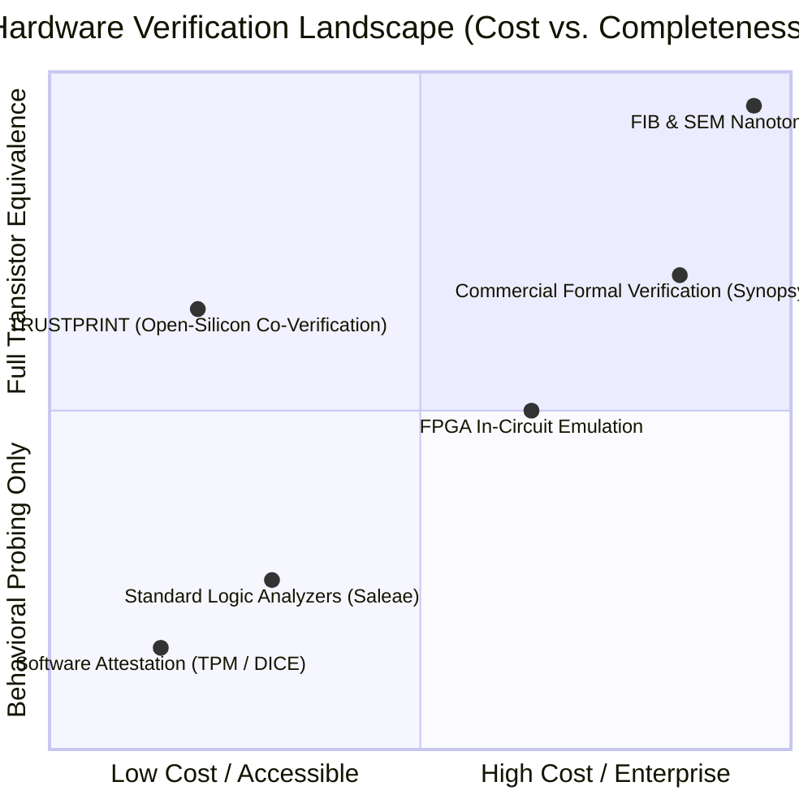

# Research — Existing Solutions & Prior Art

**Document Reference:** RES-PRIOR-001  
**Project:** TRUSTPRINT  
**Version:** 0.1.0-alpha  

---

## 1. Survey of the Semiconductor Verification Landscape

Validating whether a fabricated physical integrated circuit matches its open-source or proprietary hardware design has historically been fractured across isolated disciplines: EDA simulation, FPGA emulation, destructive failure analysis, and software attestation.

---

## 2. Comprehensive Comparison Matrix

| Platform / Tool | Verification Domain | Open Source? | Physical Chip Inspection? | Real-Time Hardware Probing? | Cryptographic Attestation? | Primary Limitations |
| :--- | :--- | :--- | :--- | :--- | :--- | :--- |
| **Traditional EDA (Cadence / Synopsys)** | Pre-silicon simulation & formal equivalence | NO (Extremely expensive licenses) | NO | NO | NO | Verifies RTL models, not fabricated physical chips. |
| **Destructive Failure Analysis (FIB / SEM)** | Post-silicon structural physical reverse-engineering | NO (Requires multi-million dollar cleanroom) | YES (Nanometer resolution) | NO (Chip is destroyed during test) | NO | Destroys the specimen; completely inaccessible to independent researchers. |
| **IRIS by bunnie Huang** | Post-silicon optical backside die inspection | YES | YES (Macroscopic ~1050nm SWIR) | NO (Optical only, no I/O probing) | NO | Standalone optical inspection technique; does not verify active circuit timing behavior. |
| **Raspberry Pi RP2040 PIO** | Microcontroller programmable I/O | YES (Permissive) | NO (Proprietary silicon packaging) | YES (State-machine bit-banging) | NO | CISC state-machine has large silicon area footprint; limited to 133 MHz; lacks RISC-V C programmability. |
| **DICE / TPM Hardware Attestation** | Firmware boot integrity measurement | PARTIALLY | NO | NO | YES | Attests firmware hash measurements; proves nothing about silicon RTL fidelity. |
| **TRUSTPRINT** | **Integrated open-silicon co-verification suite** | **YES (100% MIT License)** | **YES (IRIS SWIR Integration)** | **YES (4x 700 MHz BIO Cores)** | **YES (Hardware TRNG + Ed25519)** | **Cannot resolve individual nanometer gates optically; bounded by physical pin visibility.** |

