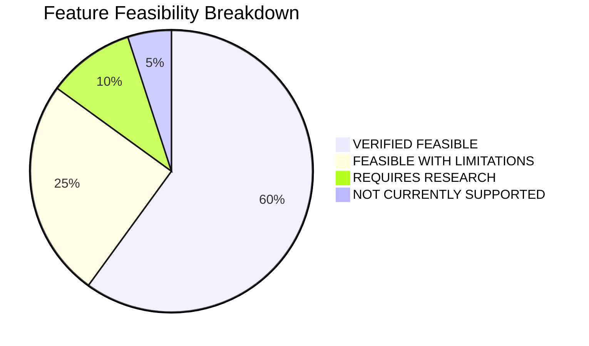

# Research — Feasibility Study & Risk Breakdown

**Document Reference:** RES-FEAS-001  
**Project:** TRUSTPRINT  
**Version:** 0.1.0-alpha  

---

## 1. Feature Feasibility Classification

Every proposed feature in TRUSTPRINT is evaluated across technical maturity, repository dependencies, hardware support, and implementation complexity for a solo developer.

---

## 2. Detailed Capability Assessments

### Category A: VERIFIED FEASIBLE
- **BIO Simulation (`bio-sim`):** Verilator compiles the `bio_bdma_wrapper.sv` block directly into an executable simulation harness. Official test configs (`hello-world.jsonc`) already demonstrate deterministic GPIO toggling.
- **BIO Hardware Execution:** 4x PicoRV32 cores run at 700 MHz, controlled via memory-mapped APB registers.
- **Waveform Extraction (FST):** Verilator natively writes `.fst` traces, readable by GTKWave and binary parsing libraries.
- **Xous App Development:** `cargo xtask dabao dabao-console` compiles pure Rust microkernel binaries with UF2 packaging.
- **Hardware Cryptography:** Xous wraps Baochip-1x hardware TRNG and SHA-512 engines in userland server APIs.
- **MMU Process Isolation:** Hardware Sv39 MMU is native to the VexRiscv core and managed by Xous page tables.

### Category B: FEASIBLE WITH LIMITATIONS
- **RTL Structural Analysis:** Parsing arbitrary, complex SystemVerilog (e.g., packages, complex generate loops) is impractical without commercial EDA tools. *Limitation:* Constrain parser to synthesizable module headers, port declarations, and parameter definitions.
- **IRIS Optical Correlation:** Full sub-micron standard cell gate tracing is impossible due to optical diffraction (~1050nm wavelength limits resolution to $\sim 0.5\ \mu\text{m}$). *Limitation:* Align macro-scale architectural functional blocks (SRAM, ReRAM, CPU, security mesh perimeter) rather than individual gates.
- **Evidence Attestation:** Hardware signing requires running on active Dabao board. *Limitation:* Provide a software development signing key fallback for host-only unit testing.

### Category C: REQUIRES RESEARCH
- **RTL-to-Physical Timing Calibration:** Deriving exact propagation delay equations connecting 22nm standard cell delays to observed physical pin jitter across temperature corners.
- **Multi-Core BIO Lockstep:** Coordinating all four cores simultaneously without deadlocks under complex dynamic workloads.

### Category D: NOT CURRENTLY SUPPORTED
- **Transistor-Level Equivalence Proof:** Proving that physical silicon contains zero dormant, non-functional gates without destructive de-layering and scanning electron microscopy.
- **Sub-Picosecond Real-Time Oscilloscope Capture:** Dabao board does not contain gigahertz-grade analog sampling circuitry; external high-speed logic analyzers are required for external analog timing verification.

