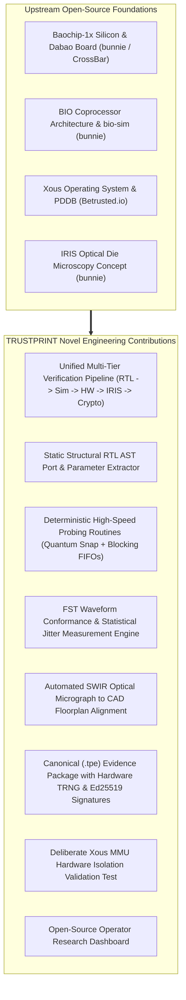

# Research — Novelty Analysis & Innovation Statement

**Document Reference:** RES-NOV-001  
**Project:** TRUSTPRINT  
**Version:** 0.1.0-alpha  

---

## 1. What Already Exists vs. What TRUSTPRINT Adds

To present a compelling and defensible submission to hackathon judges (including Andrew "bunnie" Huang, Mark Davis, and Jo Sung), we must clearly distinguish between existing upstream technologies and our novel contributions.

---

## 2. Novelty Breakdown Table

| Subsystem | What Upstream Provided | What TRUSTPRINT Adds (Novel Contribution) | Novelty Classification |
| :--- | :--- | :--- | :--- |
| **BIO Subsystem** | Verilog RTL, `bio-sim` harness, basic smoke test. | Multi-core deterministic probing routines combining quantum snap timing with blocking FIFOs for precision pin stimulus and roundtrip sampling. | **Novel Engineering Application** |
| **RTL Analysis** | Raw Verilog files in `dabao` repository. | Open-source static parser extracting module interfaces, port lists, and register offsets into JSON ASTs for automated test generation. | **Novel Integration** |
| **Waveform Verification** | Raw `.fst` trace emission from Verilator. | Streaming edge transition extractor calculating period, duty cycle, and peak-to-peak jitter against expected RTL parameters. | **Novel Verification Engine** |
| **IRIS Inspection** | Hardware packaging designed for inspectability and optical concept papers. | Software image registration engine applying affine transforms to align SWIR infrared micrographs with published CAD floorplan geometry. | **Novel Software Tooling** |
| **Attestation** | Hardware crypto accelerators on Baochip-1x. | Canonical RFC 8785 JSON evidence specification (`.tpe`) binding RTL, waveforms, micrographs, and hardware signatures into an independently verifiable proof bundle. | **Novel Security Framework** |
| **Operating System** | Core Xous microkernel and system servers. | `trustprint-srv` userland service demonstrating Sv39 MMU memory protection with deliberate hardware fault trap tests. | **Novel OS Application** |

---

## 3. Defensible Hackathon Innovation Statement

> *"TRUSTPRINT is the first open-source hardware verification platform to unify static RTL analysis, cycle-accurate coprocessor probing, non-destructive optical die inspection, and hardware-backed cryptographic attestation into a single, reproducible workflow on a production 22nm RISC-V SoC."*

