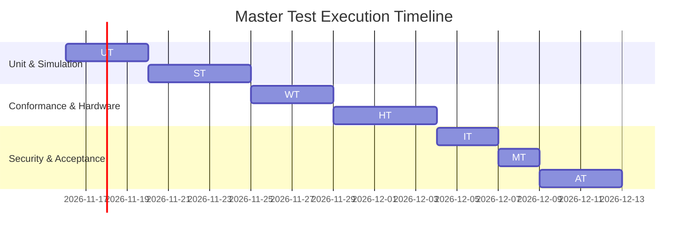

# Test — Master Verification & Validation Plan

**Document Reference:** TEST-PLAN-001  
**Project:** TRUSTPRINT  
**Version:** 0.1.0-alpha  

---

## 1. Test Strategy Overview

The Master Test Plan establishes systematic verification across the five epistemic tiers of TRUSTPRINT:
1. **Tier 1 (RTL):** Unit tests for Verilog syntax parsing and AST generation.
2. **Tier 2 (Simulation):** `bio-sim` Verilator cycle-accurate simulation and FST waveform validation.
3. **Tier 3 (Physical I/O):** Dabao hardware-in-the-loop (HIL) GPIO probing at 700 MHz.
4. **Tier 4 (Optical):** IRIS infrared die micrograph alignment and CAD bounding box registration.
5. **Tier 5 (Crypto & MMU):** Ed25519 signature verification and Sv39 process isolation traps.

---

## 2. Test Execution Schedule & Phasing

---

## 3. Test Pass/Fail Criteria
- **Simulation Tests:** 100% pass rate; zero FIFO deadlocks or dropped APB transactions.
- **Waveform Conformance:** Measured period and duty cycle within $\pm 2.0\%$ of theoretical model.
- **Hardware Telemetry:** Zero communication errors across 10,000 serial telemetry frames.
- **Attestation Integrity:** 100% artifact hash match; Ed25519 signature verification must return `STATUS: VALID`.
